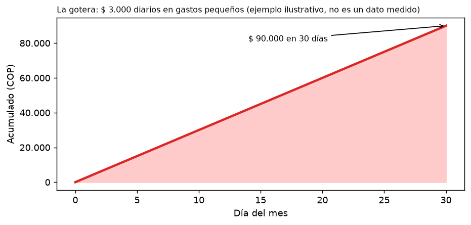
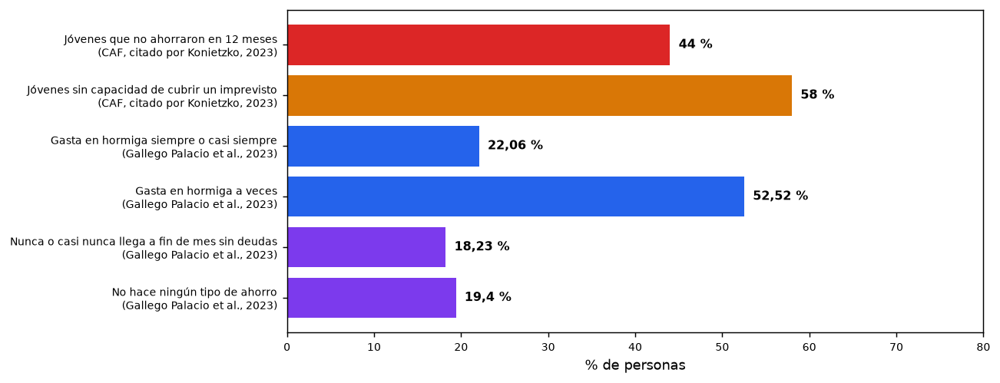

# FinTrack — Control de gastos hormiga en tus manos

> **Aplicación móvil para la gestión de gastos hormiga en jóvenes universitarios**
> Examen 2 · Segundo incremento del proyecto — Prototipo móvil funcional
> Corporación Universitaria Lasallista · Docente: Ing. Neider Xavier Vergara Humánez · Noviembre de 2026

**Integrantes:** Juan Sebastián Martínez Galeano · Cesar Ocampo Raigosa · Samuel Usma Brand

| Entregable | Dónde está |
|---|---|
| A. Código fuente | Este repositorio (`lib/`, `android/`, `assets/`) |
| B. Demostración visual | [Sección «Demostración visual»](#demostración-visual-ejecución-en-un-xiaomi-redmi-note-13-pro-5g) y `docs/capturas/` |
| C. Informe técnico (PDF) | [`docs/FinTrack_Avance2_Informe_Tecnico.pdf`](docs/FinTrack_Avance2_Informe_Tecnico.pdf) |
| Informe técnico (fuente MD) | [`docs/Sustentacion_y_Guia_de_Desarrollo_FinTrack_Avance2.md`](docs/Sustentacion_y_Guia_de_Desarrollo_FinTrack_Avance2.md) |
| Planificación integral (teoría completa) | [`docs/FinTrack_Segunda_Entrega.md`](docs/FinTrack_Segunda_Entrega.md) |
| Diseño y prototipo en Figma | [Prototipo navegable](https://www.figma.com/proto/3dFgO0jReUQgWHXaXLZOin/fintrak?node-id=15-312&starting-point-node-id=15%3A293) · [Archivo de diseño](https://www.figma.com/design/3dFgO0jReUQgWHXaXLZOin/fintrak?node-id=21-761) |
| Lo que aún no se aplica | [`PENDIENTES_NO_APLICADOS.md`](PENDIENTES_NO_APLICADOS.md) |

---

## 1. Marco teórico

### 1.1 El problema: la gotera

Muchas personas viven una escena repetida: **el dinero que ganan durante el mes parece desaparecer al llegar el final**, y no saben explicar cómo. No fue una compra grande, sino un billete de baja denominación una y otra vez, como la gotera que vacía un balde. Esos son los **gastos hormiga**: desembolsos de bajo valor y alta frecuencia que pasan inadvertidos y reducen la capacidad de ahorro (Roldán, 2017; CONDUSEF, 2024).



El problema no es un consumo aislado, sino la **falta de visibilidad sobre su repetición, su categoría y su impacto acumulado**. Transporte, comidas fuera de casa, domicilios o pagos digitales parecen manejables por separado; sin registro es imposible saber cuánto va a necesidades, comodidades o impulsos.

### 1.2 Población

La población principal son **jóvenes y estudiantes universitarios mayores de 18 años**, que empiezan a administrar ingresos propios con poca experiencia financiera.

- 44 % de los jóvenes colombianos no ahorró en los últimos 12 meses y 58 % no podría cubrir un imprevisto sin préstamo o ayuda (CAF, 2019, citado por Konietzko, 2023).
- En la IU Digital de Antioquia (417 encuestados, 81,5 % estudiantes): 22,06 % gasta en cosas innecesarias siempre o casi siempre y 52,52 % a veces; 18,23 % nunca o casi nunca llega a fin de mes sin deudas y 19,4 % no ahorra (Gallego Palacio et al., 2023).



### 1.3 Justificación

El gasto hormiga deteriora recursos que podrían ir a un fondo de emergencia, a educación o a metas de ahorro. Registrar y revisar los gastos cotidianos es la condición para cambiar el patrón (CONDUSEF, 2024). FinTrack convierte movimientos dispersos en información útil: se registra el gasto en el momento, se clasifica, se ve la suma semanal o mensual y se contrasta con un límite propio. No prohíbe el consumo: ofrece una **pausa informada**, sin pedir datos bancarios.

### 1.4 Estado del arte

| Criterio | Mobills | Monefy | Fintonic | **FinTrack** |
|---|---|---|---|---|
| Registro de gastos e ingresos | Sí | Sí, en un toque | Conecta cuentas bancarias | Sí, con teclado propio |
| Límites y avisos | Presupuestos y metas | No se menciona | No se menciona | Límites hormiga y por categoría, aviso al 80 % |
| Sin conexión | Sincroniza en la nube | No se menciona | Requiere open banking | Base local; nube opcional (siguiente incremento) |
| Enfoque en el gasto pequeño repetido | No | No | No | Etiqueta «Hormiga» y tablero de acumulados |

### 1.5 Solución

FinTrack es un **cuaderno personal de gastos e ingresos** para Android, hecho en **Flutter**. Flujo: **registrar → clasificar → comprender → decidir.**

---

## 2. Qué hace este incremento

| Módulo | Funcionalidad |
|---|---|
| Bienvenida | Splash, guía de 3 pasos con ilustraciones, crear cuenta / iniciar sesión (cuenta local), elegir dónde guardar los datos |
| Registro | Botón central «+», ingreso o gasto, 11 categorías con íconos, fecha, teclado numérico propio, nota, **foto del tiquete** (cámara o galería), vibración al guardar |
| Clasificación | Gasto ≤ $20.000 → **hormiga**; Hogar, Educación, Salud y Teléfono → **fijo**; el resto → **necesario** |
| Inicio | Saldo disponible, resumen semanal con gráfico de área y variación frente a la semana anterior, actividad reciente |
| Movimientos | Lista por día con pestañas Todos / Ingresos / Gastos; detalle con editar y eliminar |
| Estadísticas | Semana / Mes / Año, dona fijo-necesario-hormiga, balance y principales categorías |
| Informe | Patrimonio neto, activos y pasivos, **extracto en PDF** tipo bancario con la paleta FinTrack, visor y compartir |
| Límites y avisos | Límite hormiga semanal y mensual, límites por categoría, avisos internos (hormiga, buen camino, 80 % y 100 %) |
| Datos | Exportar e importar copia JSON, modo oscuro, perfil, datos personales, eliminar cuenta, política de privacidad |
| Estados | Carga (esqueleto), vacío, error y sin conexión, con ilustraciones propias |

### Arquitectura (MVVM con Provider)

```
lib/
├── main.dart                     # Arranque, Provider y tema claro/oscuro
├── models/models.dart            # Movement, AssetItem, LimitItem, categorías y regla «hormiga»
├── state/app_state.dart          # ViewModel (ChangeNotifier): cálculos, límites, avisos, conectividad
├── services/
│   ├── database_helper.dart      # SQLite fintrack.db (movements, assets, limits)
│   ├── preferences_service.dart  # SharedPreferences: cuenta local (sal + SHA-256) y ajustes
│   └── pdf_report_service.dart   # Extracto financiero en PDF (pdf)
├── theme/fintrack_theme.dart     # Paleta del Figma (claro y oscuro) y componentes
└── views/                        # Pantallas: auth, shell (pestañas), agregar, informe, perfil, más
```

### Persistencia

| Mecanismo | Qué guarda |
|---|---|
| **SQLite** (`sqflite`, `fintrack.db`) | Movimientos, activos y pasivos, límites |
| **SharedPreferences** | Cuenta local y sesión, guía vista, modo oscuro, avisos, notificaciones leídas |
| **Filesystem** (`path_provider`) | Fotos de tiquetes, PDFs del informe y copia `fintrack_respaldo.json` |

### Capacidades móviles

| Capacidad | Paquete | Necesidad que resuelve |
|---|---|---|
| Cámara y galería | `image_picker` | Guardar el comprobante de compras informales (tiquetes que se pierden) |
| Vibración | `HapticFeedback` | Confirmar el registro sin mirar la pantalla mientras se camina |
| Red | `connectivity_plus` | Mostrar «Sin conexión» sin bloquear el uso: la app es *offline-first* |
| Compartir | `printing` | Enviar o guardar el extracto PDF desde el visor |

---

## Demostración visual (ejecución en un Xiaomi Redmi Note 13 Pro 5G)

| | | |
|---|---|---|
|  **1. Inicio de la app.** Splash con la mascota. |  **2. Guía.** Primera de tres pantallas. |  **3. Crear cuenta.** Ingreso de datos (cuenta local). |
|  **4. Dónde guardar.** Solo en el teléfono; nube en el siguiente incremento. |  **5. Inicio vacío.** Saldo en $ 0. |  **6. Agregar.** Gasto en Alimentos. |
|  **7. Monto.** $ 3.500 con nota. |  **8a. Permiso de cámara.** Android lo pide al adjuntar. |  **8. Cámara.** Captura del tiquete. |
|  **8b. Tiquete adjunto.** Foto guardada en la app. |  **9. Gasto registrado.** Marcado como hormiga. |  **10. Inicio con datos.** Saldo $ 91.500 tras un ingreso y dos gastos. |
|  **11. Movimientos.** Lista del día. |  **12. Detalle.** Con tiquete, editar y eliminar. |  **13. Estadísticas.** Fijo, necesario y hormiga. |
|  **14. Informe.** Patrimonio neto. |  **15. Informe listo.** PDF generado. |  **16. Visor del PDF.** Extracto tipo bancario. |
|  **17. Persistencia (1).** La app en recientes antes del cierre forzado (`am force-stop`). |  **18. Persistencia (2).** Al reabrir, saldo y movimientos siguen ahí. |  **19. Límites.** Progreso del gasto hormiga. |
|  **20. Modo oscuro.** Paleta oscura del Figma. | | |

---

## Cómo ejecutar

Requisitos: Flutter 3.x (probado con 3.47) y Android SDK; dispositivo con Android 8.0 o superior.

```bash
git clone https://github.com/Mogollo7/FINTRACK.git
cd FINTRACK
flutter pub get
flutter run            # dispositivo conectado por USB
flutter build apk      # APK en build/app/outputs/flutter-apk/
flutter test           # pruebas de formato de moneda y clasificación
```

## Pendiente para el siguiente incremento

Recuperación de contraseña con OTP por correo, respaldo y sincronización en la nube (Supabase), notificaciones del sistema y recordatorio diario, otras monedas e idiomas, filtros y categorías propias, y lectura automática del tiquete (OCR). Detalle en [`PENDIENTES_NO_APLICADOS.md`](PENDIENTES_NO_APLICADOS.md).

## Referencias

- Comisión Nacional para la Protección y Defensa de los Usuarios de Servicios Financieros. (2024, junio). Gastos hormiga en tu rutina de trabajo. *Revista CONDUSEF*. https://revista.condusef.gob.mx/presupuesto/gastos/2024/06/gastos-hormiga-en-tu-rutina-de-trabajo/
- Gallego Palacio, N., Agudelo Sánchez, A., Marín Quintana, M., & Romero Luján, F. (2023). Conocimiento, aplicación y manejo de las finanzas personales, y percepción del bienestar que genera en la comunidad educativa de la IU Digital de Antioquia. *Revista Innovación Digital y Desarrollo Sostenible - IDS, 4*(1), 55-65. https://doi.org/10.47185/27113760.v4n1.129
- Konietzko, D. (2023, 27 de julio). Jóvenes y educación financiera en América Latina: ¿Cómo estamos y qué podemos mejorar? *Portal FinDev*. https://www.findevgateway.org/es/blog/2023/07/jovenes-y-educacion-financiera-en-america-latina-como-estamos-y-que-podemos-mejorar
- Roldán, P. N. (2017). *Gastos hormiga: Qué son, ejemplos y cómo identificarlos*. Economipedia. https://economipedia.com/definiciones/gastos-hormiga.html

Las referencias completas en APA 7 están en [`docs/FinTrack_Segunda_Entrega.md`](docs/FinTrack_Segunda_Entrega.md#9-referencias).
