<p align="center">
  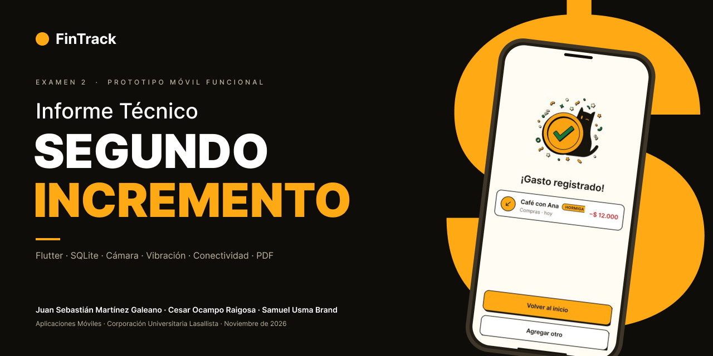
</p>

# FinTrack

Aplicación Android hecha con Flutter para anotar gastos e ingresos en segundos, detectar los **gastos hormiga** (pequeños y repetidos) y avisar antes de pasar un límite propio. Funciona sin conexión: los datos viven en el teléfono (SQLite, preferencias y archivos).

Corporación Universitaria Lasallista · Aplicaciones Móviles · Docente: Ing. Neider Xavier Vergara Humánez · Noviembre de 2026
Equipo: Juan Sebastián Martínez Galeano, Cesar Ocampo Raigosa, Samuel Usma Brand.

## Entregables del Examen 2

| | Entregable | Dónde está |
|---|---|---|
| A | Código fuente | Este repositorio: `lib/`, `android/`, `assets/`, `test/` |
| B | Demostración visual (pantallazos con descripción) | [Sección «Demostración»](#demostración-visual) y `docs/capturas/` |
| C | Informe técnico corto (8 puntos) | [`docs/Sustentacion_y_Guia_de_Desarrollo_FinTrack_Avance2.md`](docs/Sustentacion_y_Guia_de_Desarrollo_FinTrack_Avance2.md) |
| — | Pruebas de tiempo y accesibilidad | [`docs/pruebas/PRUEBAS.md`](docs/pruebas/PRUEBAS.md) |
| — | Decisiones técnicas (ADR-007 a 011) | [`docs/ADR_Examen2.md`](docs/ADR_Examen2.md) |
| — | Planificación integral y marco teórico completo | [`docs/FinTrack_Segunda_Entrega.md`](docs/FinTrack_Segunda_Entrega.md) |
| — | Lo que aún no se aplica | [`PENDIENTES_NO_APLICADOS.md`](PENDIENTES_NO_APLICADOS.md) |

El informe tiene los 8 puntos que pide el docente: funcionalidades, cambios frente al Examen 1, flujo, persistencia, capacidad móvil y su justificación, evidencia en Android, limitaciones y pendientes.

## Inicio rápido

Requisitos: Flutter 3.x (probado con 3.47) y Android SDK; un teléfono con Android 8.0 o superior, o un emulador.

```bash
git clone https://github.com/Mogollo7/FINTRACK.git
cd FINTRACK
flutter pub get
```

| Comando | Qué hace |
|---|---|
| `flutter run` | Instala y abre la app en el dispositivo conectado (compilación *debug*) |
| `flutter build apk` | Genera el APK en `build/app/outputs/flutter-apk/` |
| `flutter analyze` | Análisis estático |
| `flutter test` | Pruebas de formato de moneda y de la regla del gasto hormiga |

## Qué hace este incremento

El flujo principal es: **registrar → clasificar → consultar → modificar → informe**.

| Módulo | Funcionalidad |
|---|---|
| Cuenta | Splash, guía de 3 pasos, crear cuenta e iniciar sesión (cuenta local), elegir dónde guardar los datos |
| Registro | Botón «+», ingreso o gasto, 11 categorías, fecha, teclado propio, **montos rápidos** ($2.000, $5.000, $10.000), nota, foto del tiquete (cámara o galería) y vibración al guardar |
| Clasificación | Gasto ≤ $20.000 → hormiga; Hogar, Educación, Salud y Teléfono → fijo; el resto → necesario |
| Inicio | Saldo, resumen semanal con gráfico, variación frente a la semana anterior y la equivalencia «dinero invisible» (por ejemplo, «equivale a 1 café») |
| Movimientos | Lista por día, pestañas Todos / Ingresos / Gastos, filtro por categoría, detalle, **editar y eliminar** |
| Límites | Límite hormiga semanal y mensual, límites por categoría, aviso al 80 %, y una pausa «¿Seguro?» antes de guardar un gasto que supera un límite |
| Estadísticas e informe | Semana / Mes / Año, dona fijo-necesario-hormiga, patrimonio neto y **extracto en PDF** con visor y botón compartir |
| Datos | Exportar e importar copia JSON, modo oscuro, perfil, eliminar cuenta |
| Estados | Carga, vacío, error y sin conexión, con ilustraciones propias |

## Arquitectura

Tres capas, como pide la rúbrica: interfaz → estado y lógica → datos.

```
lib/
├── main.dart                     # Arranque, Provider, tema claro/oscuro
├── models/models.dart            # Movement, AssetItem, LimitItem, categorías, regla «hormiga»
├── state/app_state.dart          # ViewModel (ChangeNotifier): cálculos, límites, avisos, conectividad
├── services/
│   ├── database_helper.dart      # SQLite fintrack.db: movements, assets, limits
│   ├── preferences_service.dart  # SharedPreferences: cuenta local y ajustes
│   └── pdf_report_service.dart   # Extracto financiero en PDF
├── theme/fintrack_theme.dart     # Paleta del Figma (claro y oscuro)
└── views/                        # Pantallas (cuenta, pestañas, agregar, informe, perfil…)
```

Las decisiones y sus alternativas están en [`docs/ADR_Examen2.md`](docs/ADR_Examen2.md): Provider en lugar de Riverpod, `image_picker` en lugar de `camera`, cuenta local con sal + SHA-256, sin geolocalización y la regla automática del gasto hormiga.

### Persistencia

| Mecanismo | Qué guarda |
|---|---|
| SQLite (`sqflite`) | Movimientos, activos y pasivos, límites |
| SharedPreferences | Cuenta local y sesión, guía vista, modo oscuro, avisos, notificaciones leídas |
| Filesystem (`path_provider`) | Fotos de tiquetes, PDFs y la copia `fintrack_respaldo.json` |

### Capacidades móviles

| Capacidad | Paquete | Necesidad que resuelve |
|---|---|---|
| Cámara y galería | `image_picker` | Guardar el comprobante de compras informales, que se pierden en papel |
| Vibración | `HapticFeedback` | Confirmar el registro sin mirar la pantalla mientras se camina |
| Red | `connectivity_plus` | Mostrar «Sin conexión» sin bloquear: todo funciona local |
| Compartir | `printing` | Enviar o guardar el extracto PDF |

Si se rechaza el permiso de cámara, la app avisa y deja guardar el gasto sin tiquete.

## Demostración visual

Capturas tomadas en un **Xiaomi Redmi Note 13 Pro 5G** (Android, USB, compilación *debug*). Cada una está explicada en la sección 9 del [informe](docs/Sustentacion_y_Guia_de_Desarrollo_FinTrack_Avance2.md).

| | | |
|---|---|---|
| 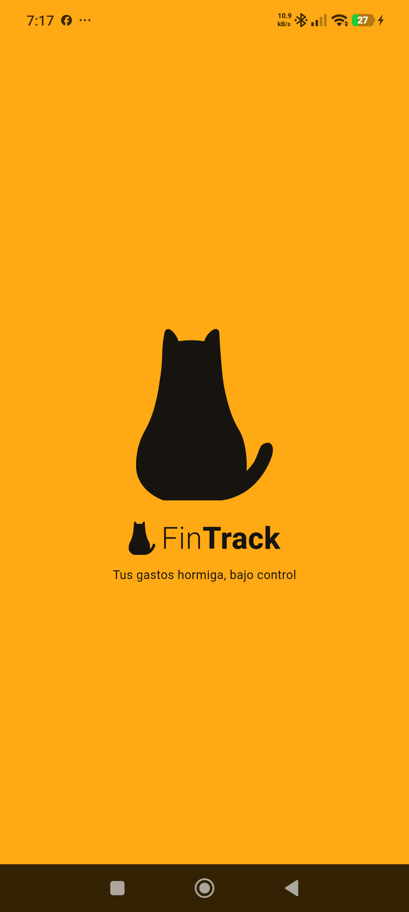 **Inicio de la app.** Splash. | 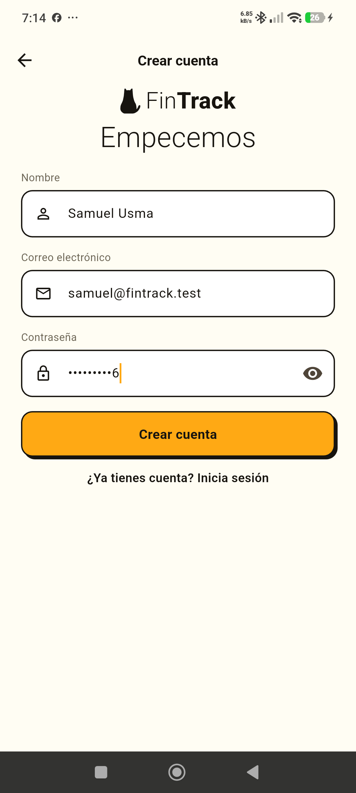 **Ingreso de datos.** Crear cuenta. | 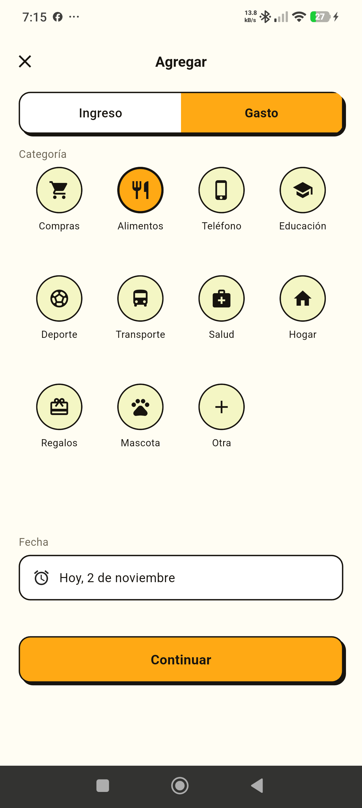 **Flujo principal.** Agregar un gasto. |
| 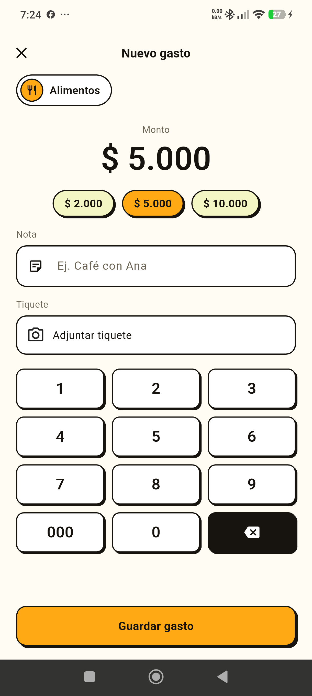 **Montos rápidos.** Un toque fija el valor. | 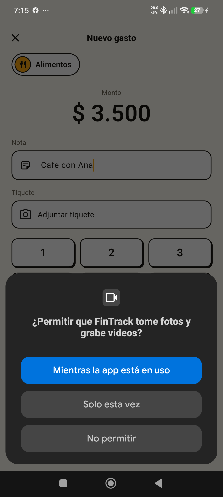 **Capacidad móvil.** Android pide el permiso de cámara. | 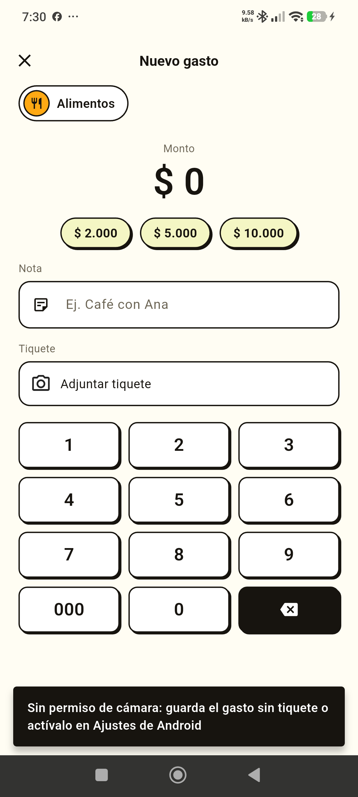 **Permiso rechazado.** Se puede guardar sin tiquete. |
| 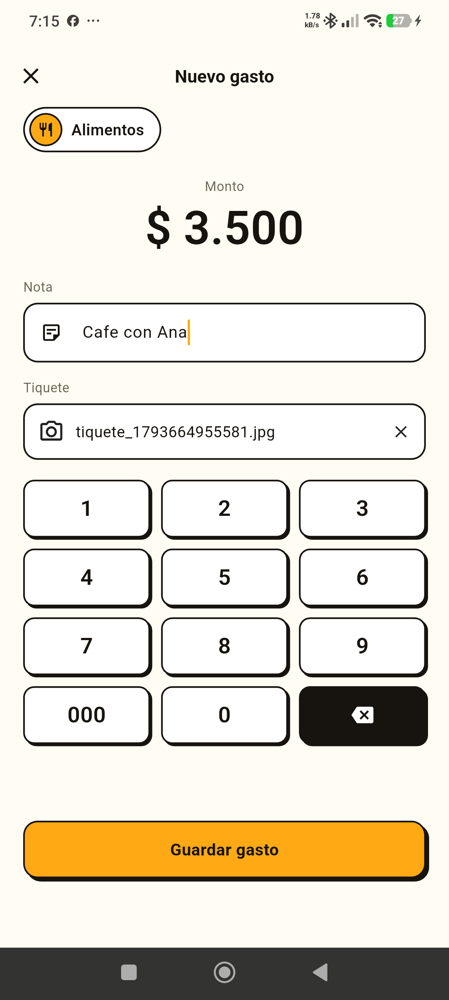 **Tiquete adjunto.** Foto copiada a la app. | 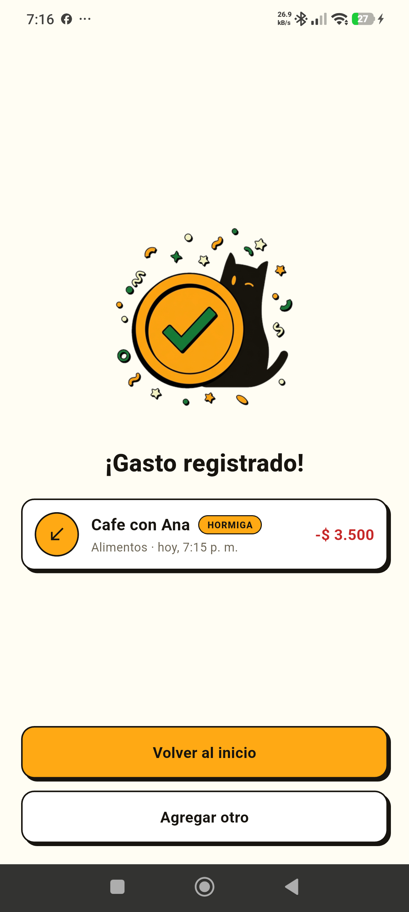 **Resultado.** Gasto registrado como hormiga. | 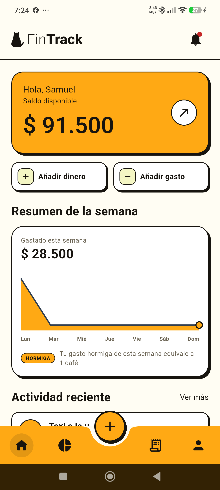 **Visualización.** Saldo y «dinero invisible». |
| 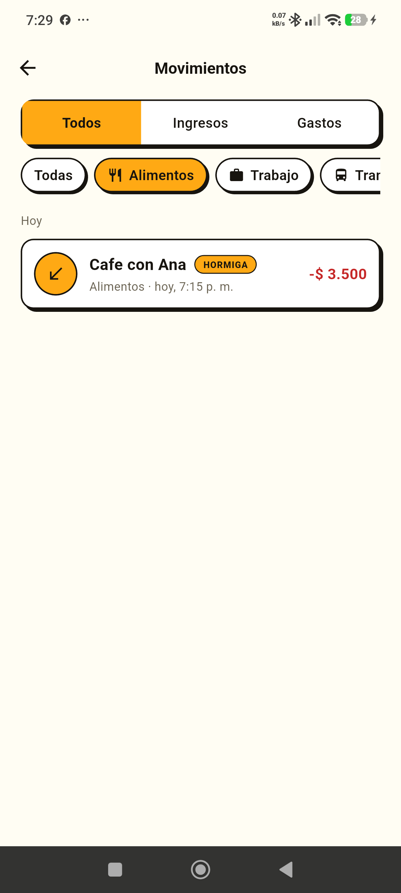 **Consulta.** Filtro por categoría. | 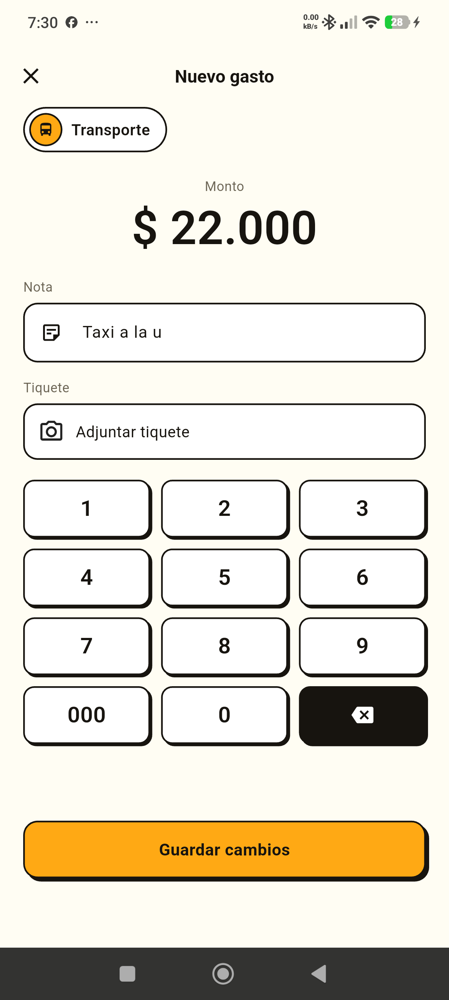 **Modificación.** Editar un movimiento. | 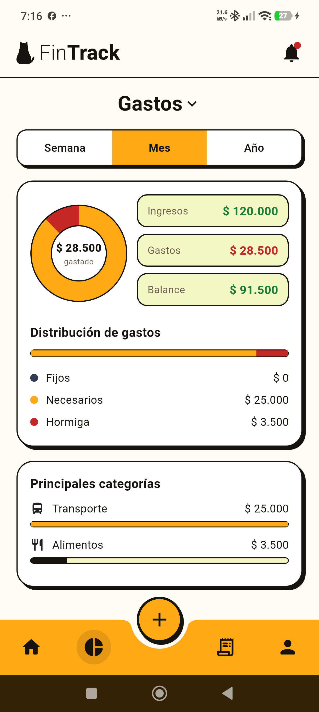 **Estadísticas.** Fijo, necesario, hormiga. |
| 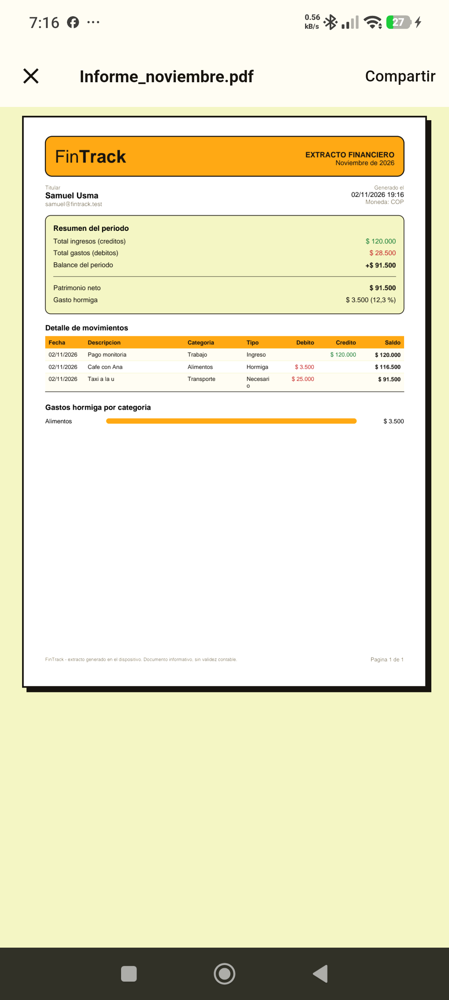 **Informe.** Extracto en PDF. | 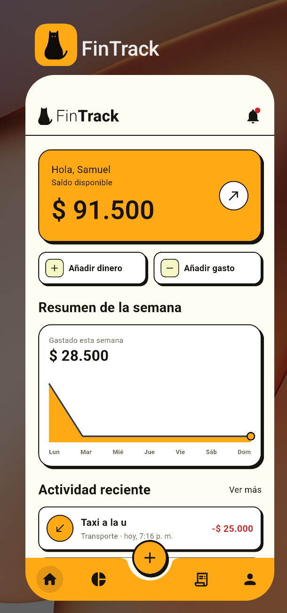 **Persistencia (1).** Cierre forzado de la app. | 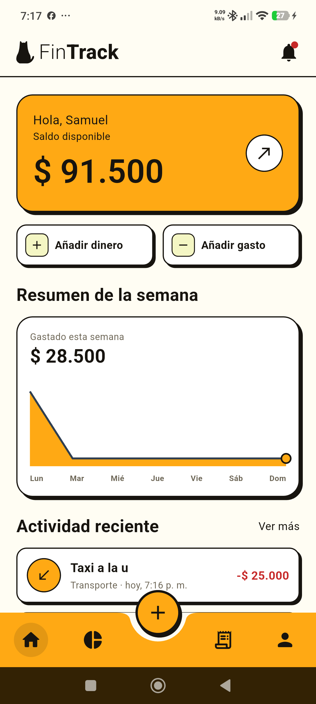 **Persistencia (2).** Al reabrir, los datos siguen. |
| 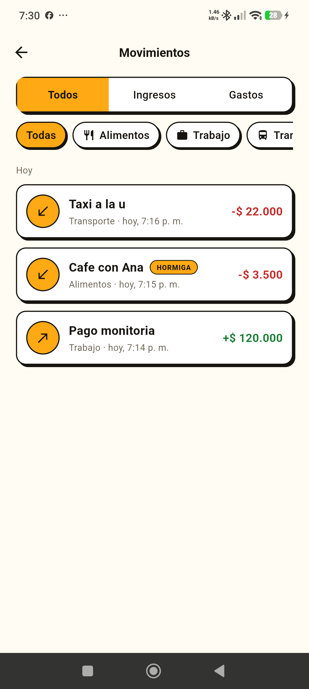 **Persistencia de la edición.** $ 22.000 tras reiniciar. | 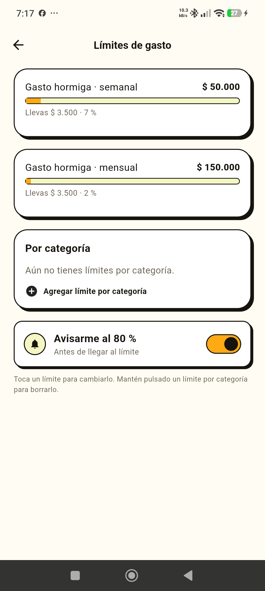 **Límites.** Progreso del gasto hormiga. | 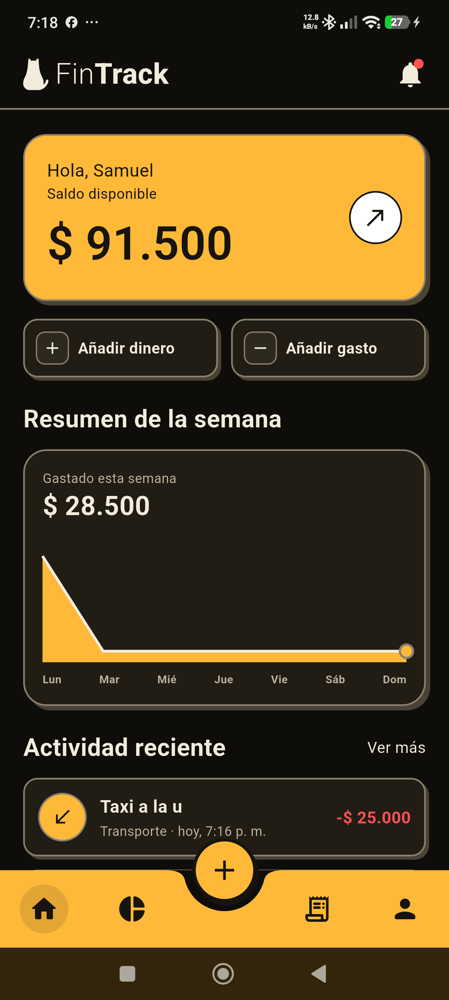 **Modo oscuro.** |

Prueba de persistencia realizada: crear un ingreso y dos gastos → cerrar la app con `am force-stop` → abrirla → los tres movimientos y el saldo ($ 91.500) siguen; luego se editó un gasto de $ 25.000 a $ 22.000, se reinició y el cambio permanece.

## Pruebas de tiempo y accesibilidad

Medidas en el mismo Xiaomi, compilación *debug* (detalle, método y límites en [`docs/pruebas/PRUEBAS.md`](docs/pruebas/PRUEBAS.md)):

| Prueba | Resultado |
|---|---|
| Arranque en frío (10 veces) | media 2,47 s (2,39–2,70 s) |
| Registro de un gasto con monto rápido (10 veces) | ~2,5 s con las pausas de la prueba; meta del proyecto < 3 s |
| Contraste de color WCAG AA | 15 de 15 pares cumplen |
| Objetivos táctiles | 20 de 99 medían menos de 48 dp; se corrigieron las pestañas y chips y se re-midió Movimientos |
| Fluidez (cuadros lentos) | no se pudo medir (Flutter no reporta en `gfxinfo`; requiere build *profile*) |

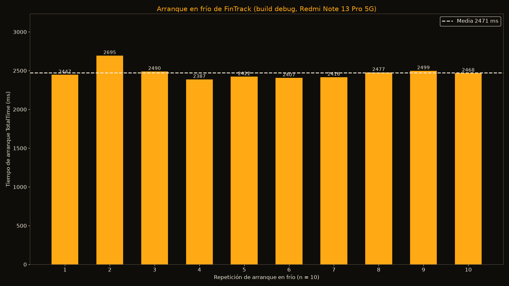
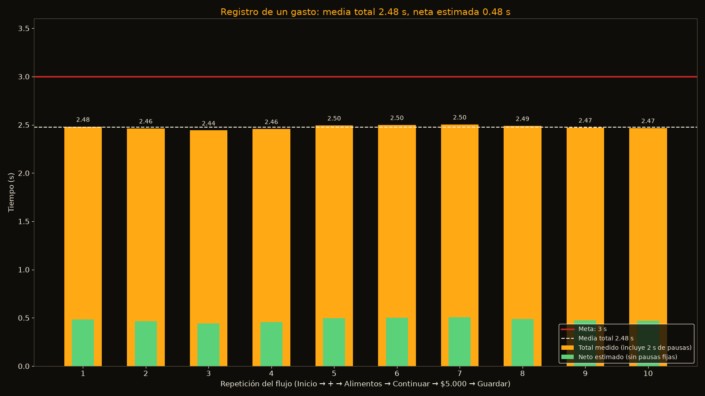
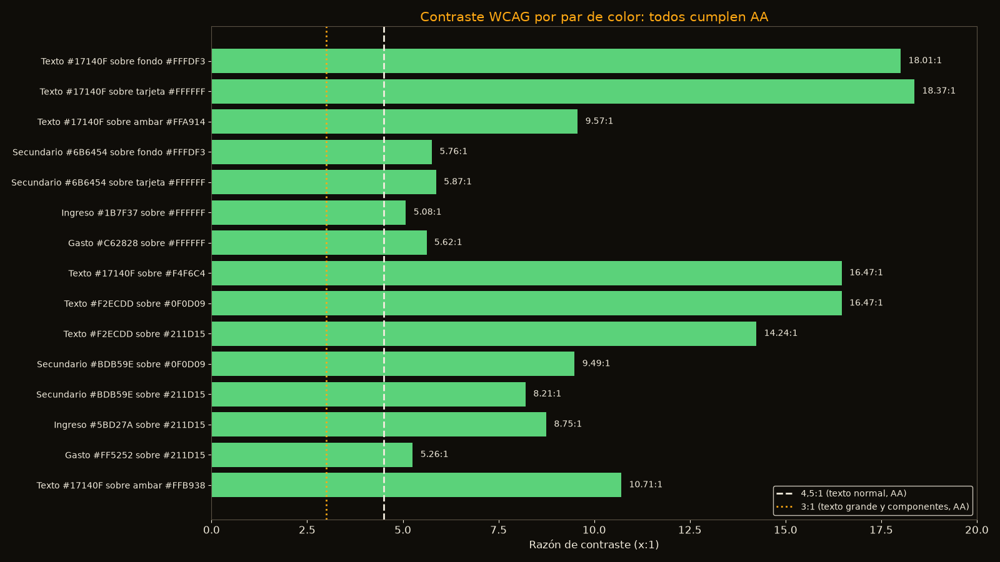

## Marco teórico

### El problema: la gotera

El dinero del mes parece desaparecer al llegar el final y no se sabe explicar cómo. No fue una compra grande, sino billetes de baja denominación una y otra vez, como la gotera que vacía un balde. Esos son los **gastos hormiga**: desembolsos de bajo valor y alta frecuencia que pasan inadvertidos y reducen la capacidad de ahorro (Roldán, 2017; CONDUSEF, 2024). El problema no es el consumo aislado sino la falta de visibilidad sobre su repetición, su categoría y su suma.


### Población

Jóvenes y estudiantes universitarios mayores de 18 años, que empiezan a administrar ingresos propios con poca experiencia financiera.

- 44 % de los jóvenes colombianos no ahorró en los últimos 12 meses y 58 % no podría cubrir un imprevisto sin préstamo o ayuda (CAF, 2019, citado por Konietzko, 2023).
- En la IU Digital de Antioquia (417 encuestados, 81,5 % estudiantes), 22,06 % gasta en cosas innecesarias siempre o casi siempre y 52,52 % a veces; 18,23 % nunca o casi nunca llega a fin de mes sin deudas y 19,4 % no ahorra (Gallego Palacio et al., 2023).


### Justificación y solución

Registrar y revisar los gastos cotidianos es la condición para cambiar el patrón (CONDUSEF, 2024). FinTrack registra el gasto en el momento, lo clasifica, muestra la suma semanal o mensual y la contrasta con un límite propio. No prohíbe el consumo: ofrece una pausa informada y no pide datos bancarios.

| Criterio | Mobills | Monefy | Fintonic | FinTrack |
|---|---|---|---|---|
| Registro de gastos e ingresos | Sí | Sí, en un toque | Conecta cuentas bancarias | Sí, con teclado propio |
| Límites y avisos | Presupuestos y metas | No se menciona | No se menciona | Límite hormiga y por categoría, aviso al 80 % |
| Sin conexión | Sincroniza en la nube | No se menciona | Requiere open banking | Base local; nube opcional después |
| Enfoque en el gasto pequeño repetido | No se menciona | No se menciona | No se menciona | Etiqueta «Hormiga» y acumulados |

Comparación con base en las fichas de cada aplicación en la App Store (detalle y fuentes en la [planificación integral](docs/FinTrack_Segunda_Entrega.md#14-estado-del-arte-versión-corregida)).

## Limitaciones y pendientes

Datos solo en el teléfono (si se desinstala, se pierden), cuenta local sin recuperación de contraseña, sin lectura automática del tiquete (OCR), fotos que quedan en el teléfono al eliminar un movimiento, y moneda e idioma fijos (COP y español). Para el siguiente incremento: recuperación por OTP y respaldo en la nube con Supabase, notificaciones del sistema y recordatorio diario, otras monedas e idiomas, y categorías propias. Detalle en [`PENDIENTES_NO_APLICADOS.md`](PENDIENTES_NO_APLICADOS.md).

## Referencias

- Comisión Nacional para la Protección y Defensa de los Usuarios de Servicios Financieros. (2024, junio). Gastos hormiga en tu rutina de trabajo. *Revista CONDUSEF*. https://revista.condusef.gob.mx/presupuesto/gastos/2024/06/gastos-hormiga-en-tu-rutina-de-trabajo/
- Gallego Palacio, N., Agudelo Sánchez, A., Marín Quintana, M., & Romero Luján, F. (2023). Conocimiento, aplicación y manejo de las finanzas personales, y percepción del bienestar que genera en la comunidad educativa de la IU Digital de Antioquia. *Revista Innovación Digital y Desarrollo Sostenible - IDS, 4*(1), 55-65. https://doi.org/10.47185/27113760.v4n1.129
- Konietzko, D. (2023, 27 de julio). Jóvenes y educación financiera en América Latina: ¿Cómo estamos y qué podemos mejorar? *Portal FinDev*. https://www.findevgateway.org/es/blog/2023/07/jovenes-y-educacion-financiera-en-america-latina-como-estamos-y-que-podemos-mejorar
- Nygard, M. (2011). *Documenting architecture decisions*. Cognitect.
- Roldán, P. N. (2017). *Gastos hormiga: Qué son, ejemplos y cómo identificarlos*. Economipedia. https://economipedia.com/definiciones/gastos-hormiga.html
