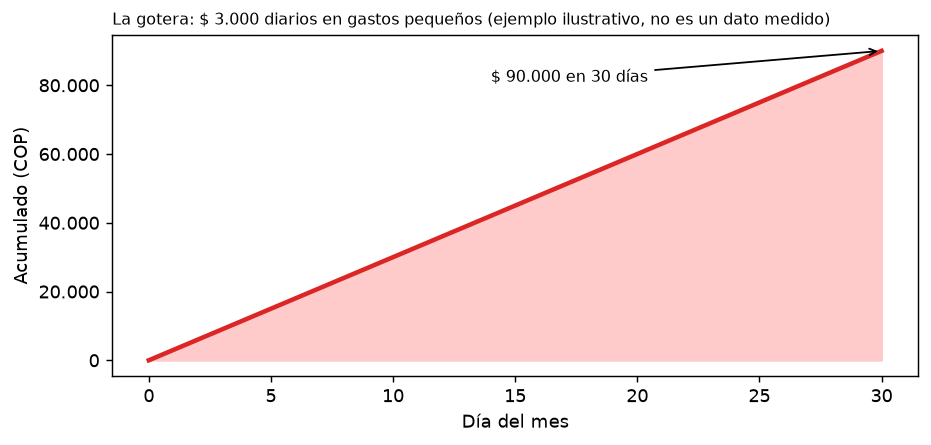
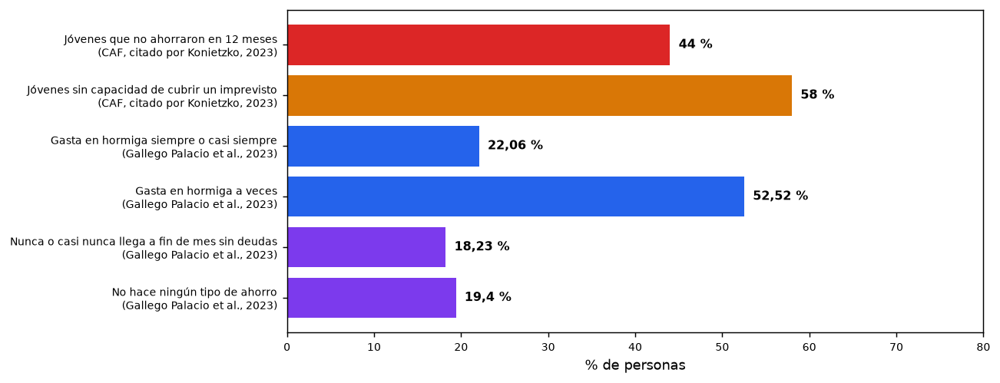
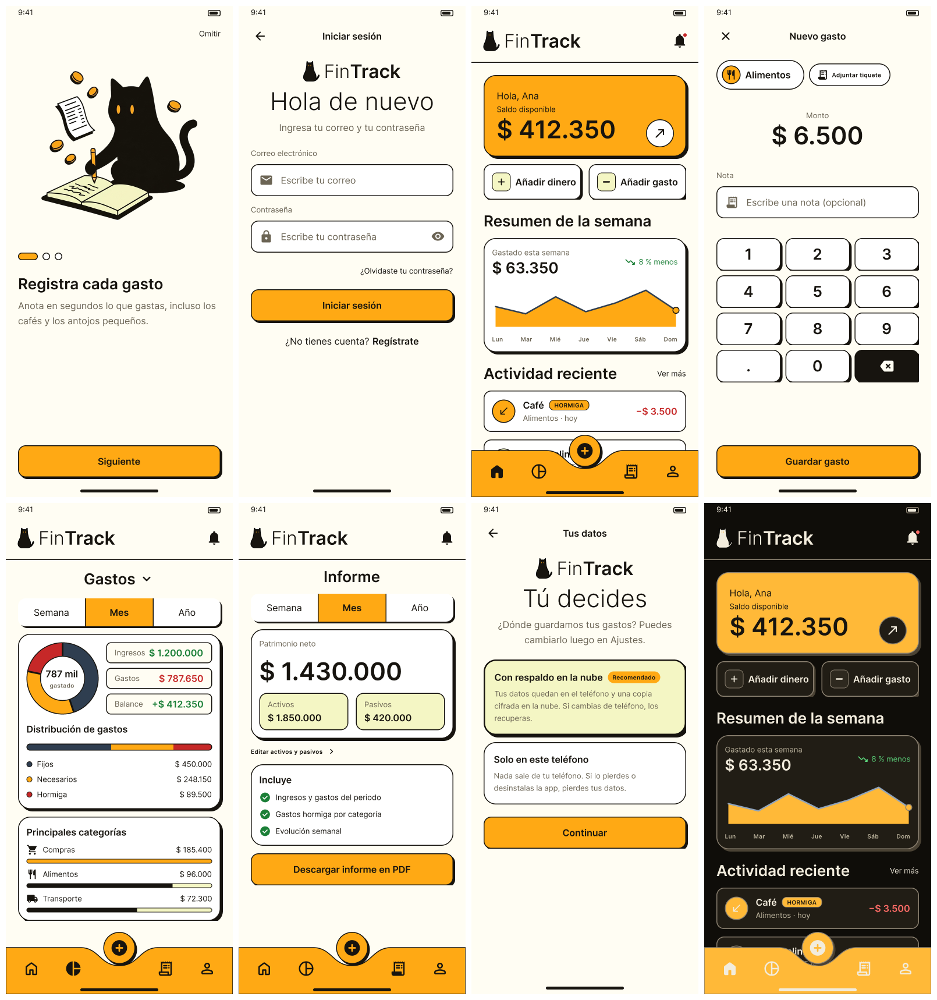
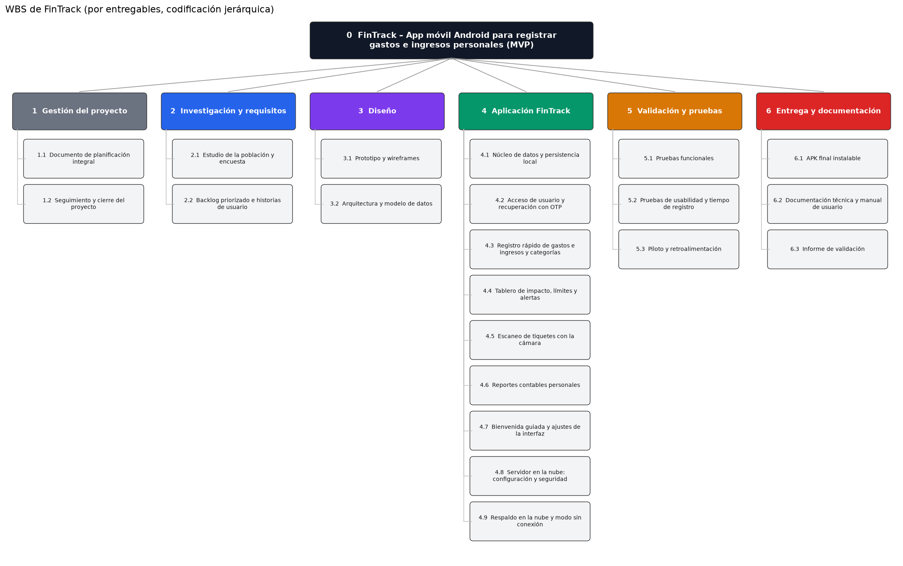
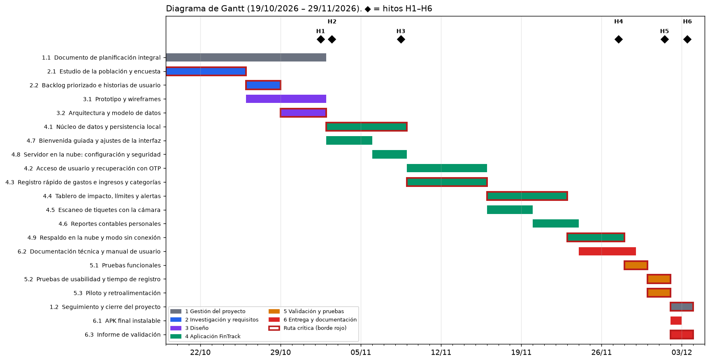
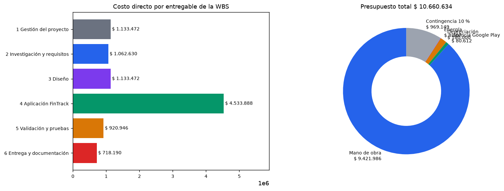
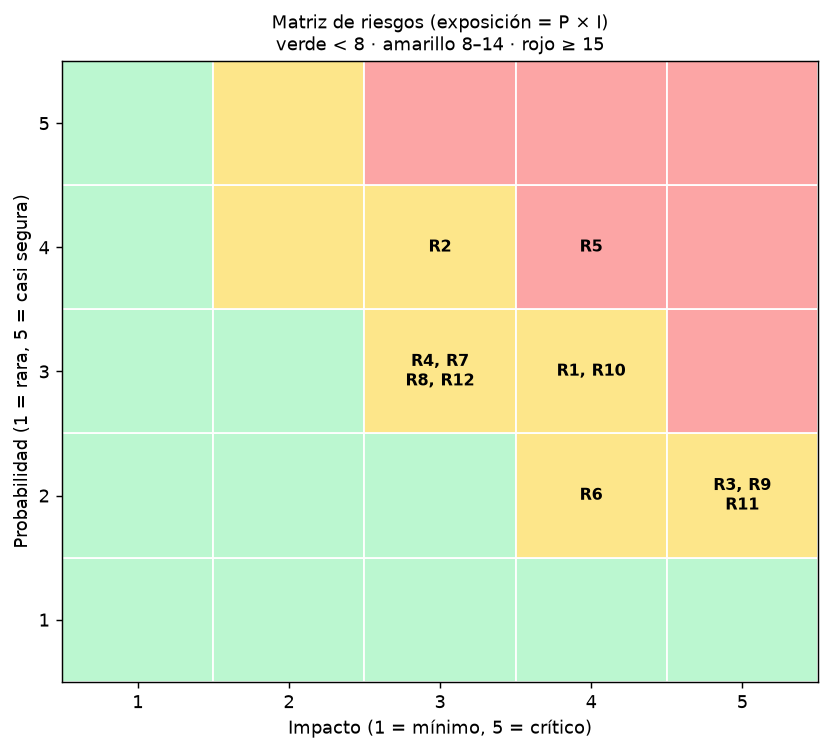

# FinTrack: Aplicación Móvil para la Gestión de Gastos Hormiga
## Planificación integral del proyecto — Segunda entrega incremental

**Equipo:** Equipo FinTrack
**Integrantes:** Juan Sebastián Martínez Galeano y Samuel Usma Brand
**Asignatura:** Gestión de Proyectos
**Docente:** Neider Xavier Vergara Humánez
**Institución:** Corporación Universitaria Lasallista
**Fecha:** 2 de noviembre de 2026

---

## Introducción

FinTrack es una aplicación móvil para Android que funciona como el **cuaderno personal de gastos e ingresos**: permite anotar en segundos los gastos pequeños y frecuentes (gastos hormiga), ver cuánto suman y recibir un aviso antes de pasarse de un límite propio. Sirve para que una persona entienda a dónde se va su dinero a fin de mes. No pretende ser una herramienta de control financiero avanzado ni de uso empresarial.

Esta segunda entrega convierte la propuesta inicial en un proyecto planificado: corrige la primera entrega, define el alcance, prioriza los requisitos, descompone el trabajo en entregables, programa las actividades, estima el presupuesto, analiza los riesgos y comprueba la coherencia entre todo lo anterior. Esta versión incorpora además el **respaldo opcional en la nube** y un **modo sin conexión** para quien prefiera guardar sus datos solo en el teléfono.

**Prototipo navegable:** [abrir el prototipo de FinTrack](https://www.figma.com/proto/3dFgO0jReUQgWHXaXLZOin/fintrak?node-id=15-312&viewport=165%2C-459%2C1.73&t=SwoJydV9BxnrWMR0-1&scaling=min-zoom&content-scaling=fixed&starting-point-node-id=15%3A293&show-proto-sidebar=1&page-id=3%3A3) · **Diseño en Figma:** [abrir el archivo de diseño](https://www.figma.com/design/3dFgO0jReUQgWHXaXLZOin/fintrak?node-id=21-761&t=01g00pwS6Ff3YR3p-1)

---

## 1. Correcciones a la primera entrega

### 1.1 Resumen de lo corregido

| Parte | Qué se corrigió | Por qué |
|---|---|---|
| Problema | Se explica con la imagen de la gotera, se organiza el estudio de la población con gráficas y se acota a jóvenes y estudiantes universitarios mayores de 18 años. | La población variaba entre secciones (de adolescentes hasta adultos de 50 años). |
| Justificación | Se agrega el costo de no intervenir y se enlaza cada beneficio con una función de la app. | La relación entre el problema y la solución era general. |
| Estado del arte | Se agregan criterios de comparación con aplicaciones del mercado y referentes de accesibilidad; se ordenan las referencias. | Solo decía «las aplicaciones de presupuesto…» y había referencias incompletas. |
| Solución | Android como única plataforma; acceso con recuperación por OTP; escaneo de tiquetes; reportes contables personales; bienvenida guiada; respaldo opcional en la nube; modo sin conexión. | Coherencia con el stack, con la facilidad de desarrollo y entre la primera y la segunda entrega. |
| Mockup | Se presenta un prototipo navegable en Figma con más de 60 pantallas, hojas, diálogos y avisos, modo oscuro y animaciones, accesible por enlace. | Las figuras anteriores no mostraban el flujo completo. |
| Planificación del trabajo | El trabajo se organiza por **entregables**, que se descomponen en componentes y **paquetes de trabajo** con **codificación jerárquica**, responsable y **criterio de aceptación**. El backlog, el cronograma y el presupuesto usan esos mismos códigos. | La retroalimentación pedía aplicar con más rigor la descomposición del trabajo en entregables y su trazabilidad. |

### 1.2 Descripción del problema (versión corregida)

Muchas personas viven una escena repetida: **el dinero que ganan durante el mes parece desaparecer al llegar el final**, y no saben explicar cómo. No fue una compra grande. Fue una moneda o un billete de baja denominación, una y otra vez, como la gotera que vacía un balde: cada gota parece insignificante, pero el balde se vacía. Esos son los gastos hormiga: desembolsos de bajo valor y alta frecuencia que pasan inadvertidos y reducen la capacidad de ahorro (Roldán, 2017; Comisión Nacional para la Protección y Defensa de los Usuarios de Servicios Financieros [CONDUSEF], 2024).

*Figura 1.* La gotera: el efecto acumulado de un gasto pequeño diario (ejemplo ilustrativo).

*Nota.* Elaboración propia (2026).

El problema no es un consumo aislado, sino la **falta de visibilidad sobre su repetición, su categoría y su impacto acumulado**. Transporte, comidas fuera de casa, suscripciones, domicilios, compras en línea y pagos digitales parecen manejables por separado; cuando no se registran, es imposible saber cuánto va a necesidades, comodidades o impulsos. Por eso el problema se formula como insuficiente visibilidad y gestión de gastos cotidianos acumulativos, y no como la simple ausencia de una aplicación (CONDUSEF, 2024; Roldán, 2017).

**Estudio de la población.** El problema afecta sobre todo a quienes empiezan a administrar ingresos propios o variables. En la vida universitaria la experiencia financiera es limitada mientras se enfrentan gastos de transporte, útiles, alimentación y ocio. Según la encuesta de capacidades financieras de CAF (2019), citada por Konietzko (2023), 44 % de los jóvenes colombianos no ahorró en los últimos 12 meses y 58 % no podría cubrir un gasto imprevisto sin recurrir a un préstamo o ayuda. En el ámbito universitario, una encuesta a 417 personas de la IU Digital de Antioquia (81,5 % estudiantes) encontró que 22,06 % gasta en cosas innecesarias o por capricho (gastos hormiga) siempre o casi siempre y 52,52 % a veces, que 18,23 % nunca o casi nunca llega a fin de mes sin recurrir a deudas y que 19,4 % no ahorra (Gallego Palacio et al., 2023).

*Figura 2.* Indicadores de ahorro y de gasto hormiga. Fuentes: CAF (2019), citado por Konietzko (2023); Gallego Palacio et al. (2023).

La población principal son **jóvenes y estudiantes universitarios mayores de 18 años**; los trabajadores y hogares son un grupo secundario para versiones posteriores. Para caracterizar el gasto hormiga en esta población, el paquete 2.1 aplica una encuesta con una meta de **al menos 30 respuestas** sobre tipos de gasto, frecuencia, valor aproximado y relación percibida con el ahorro, y el piloto (5.3) cuenta con **al menos 10 participantes**.

**Tabla 1**

*Segmentos de población y partes interesadas*

| Grupo | Rol | Necesidad o expectativa | Participación |
|---|---|---|---|
| Jóvenes y estudiantes universitarios (18 años o más) | **Principal** (usuarios y pilotos) | Control simple y resultados visibles. | Usan la app y validan con retroalimentación. |
| Trabajadores y hogares | Secundario (uso posterior) | Claridad de gastos y apoyo al ahorro. | Apoyan si perciben utilidad. |
| Entidades educativas | Aliado | Herramientas de educación financiera. | Facilitan el piloto y validan resultados. |
| Equipo FinTrack | Ejecutor | Alcance viable y mejora continua. | Diseña, prueba y corrige la solución. |
| Reguladores y entidades financieras | Contexto | Protección de datos, transparencia e inclusión. | Orientan requisitos; pueden apoyar o limitar. |

*Nota.* Elaboración propia con base en Konietzko (2023), CONDUSEF (2024) y Roldán (2017).

**Consecuencias observables** (elaboración propia con base en las fuentes anteriores)**:** menos ahorro, dificultad para cumplir metas, dependencia del crédito ante imprevistos y pérdida de control del presupuesto. El caso crítico se da cuando los gastos pequeños, recurrentes y no planeados alcanzan una parte relevante del ingreso; porcentajes bajos también pesan cuando el ingreso es parcial o inestable.

### 1.3 Justificación (versión corregida)

Intervenir es pertinente porque el gasto hormiga deteriora recursos que podrían ir a un fondo de emergencia, a educación, al pago de deudas o a metas de ahorro. Su efecto es silencioso: un consumo pequeño no cambia una decisión aislada, pero su repetición reduce el margen al final del periodo. Las recomendaciones de educación financiera destacan registrar y revisar los gastos cotidianos, porque identificar el patrón es la condición para cambiarlo (CONDUSEF, 2024).

FinTrack convierte movimientos dispersos en información útil: el usuario registra el gasto en el momento, lo clasifica, revisa la suma semanal o mensual y la contrasta con un límite propio. En vez de prohibir el consumo, ofrece una pausa informada (Konietzko, 2023; Roldán, 2017). **No intervenir** mantiene la opacidad del gasto, aplaza la formación de reservas y aumenta la fragilidad ante emergencias. El valor esperado incluye mayor conciencia de las categorías de consumo y mejor capacidad de planificación, medibles con registros, acumulados, uso de alertas y retroalimentación del piloto, sin que el usuario entregue datos bancarios.

### 1.4 Estado del arte (versión corregida)

- **Concepto:** Roldán (2017) define el gasto hormiga como un desembolso pequeño que pesa por acumulación; el análisis debe mirar frecuencia y suma, no solo el valor unitario.
- **Práctica de presupuesto:** CONDUSEF (2024) recomienda registrar todos los desembolsos y fijar un monto de libre disposición. FinTrack lo lleva al móvil con registro inmediato y límite configurable.
- **Evidencia en Colombia:** CAF (2019), citado por Konietzko (2023), muestra la vulnerabilidad financiera de los jóvenes; Gallego Palacio et al. (2023) lo llevan al contexto universitario; Banco de la República (2024) sitúa la propuesta en un entorno de billeteras móviles y pagos inmediatos; La República (2024) respalda que la tecnología ayuda a controlar el gasto hormiga.
- **Usabilidad y accesibilidad:** Apple Inc. (s. f.) aporta criterios de jerarquía visual y objetivos táctiles; las Pautas de Accesibilidad para el Contenido Web (WCAG) 2.2 fijan contraste mínimo, tamaño de objetivo táctil y texto escalable (World Wide Web Consortium [W3C], 2023).

**Aplicaciones del mercado.** Se compararon tres aplicaciones de finanzas personales con la información de sus fichas oficiales en la App Store.

**Tabla 2**

*Comparación con aplicaciones del mercado*

| Criterio | Mobills | Monefy | Fintonic | FinTrack |
|---|---|---|---|---|
| Registro de gastos e ingresos | Sí (Toro Investimentos Ltda., s. f.) | Sí, en un toque (Reflective Technologies ApS, s. f.) | Se centra en conectar cuentas bancarias (Fintonic Servicios Financieros S.L., s. f.) | Sí, en menos de 3 s con teclado propio |
| Presupuestos, metas o límites | Presupuestos y metas por categoría | No se menciona en su ficha | No se menciona en su ficha | Límites por periodo y aviso de gasto hormiga |
| Avisos | Por notificación y correo | No se menciona en su ficha | No se describen en su ficha | Avisos de hormiga, de límite y recordatorio |
| Funcionamiento sin conexión | Sincronización en la nube que funciona en línea y sin conexión | No se menciona en su ficha | Requiere conectar cuentas (open banking) | Base local; la nube es opcional |
| Enfoque en el gasto pequeño repetido | No se menciona en su ficha | No se menciona en su ficha | No se menciona en su ficha | Etiqueta «Hormiga» y tablero de acumulados |
| Costo | Gratis con límites; premium por compras dentro de la app | Gratis con compras dentro de la app (Premium por suscripción) | Gratis | Gratis (proyecto académico) |

La diferencia de FinTrack es poner el registro en menos de 3 segundos y la **acumulación visible** del gasto hormiga en el centro de la experiencia, con funcionamiento sin conexión, respaldo en la nube solo si el usuario lo decide y sin credenciales bancarias.

### 1.5 Solución (versión corregida)

FinTrack es una aplicación móvil **solo para Android 8.0 o superior**. Se eligió Android por facilidad de desarrollo con el stack decidido: **Flutter** y el lenguaje Dart, que compilan la app a un APK de Android (Flutter, s. f.-a). Su usuario principal es el joven o estudiante que quiere anotar rápido y entender el impacto de sus gastos pequeños. Es un **cuaderno personal de gastos e ingresos**, no una herramienta de control financiero avanzado.

Flujo: **registrar → clasificar → comprender → decidir.** Componentes de esta versión:

1. **Bienvenida guiada:** tres pantallas que explican el uso («Registra cada gasto», «Descubre tus hormigas», «Ahorra con metas claras») para que una persona nueva conozca la app antes de empezar.
2. **Acceso con cuenta:** crear cuenta, iniciar sesión y recuperar la contraseña con un código de un solo uso (OTP) enviado al correo.
3. **Registro rápido** de gastos e ingresos: categoría con íconos, teclado numérico propio, nota y fecha; botón central «+» siempre visible.
4. **Escaneo de tiquetes** con la cámara, para guardar el comprobante en forma digital asociado al movimiento.
5. **Tablero de impacto acumulado** por semana, mes y año: distribución en fijos, necesarios y hormiga, y principales categorías.
6. **Límites y avisos:** aviso de gasto hormiga cuando se repite un gasto pequeño, aviso al acercarse o superar el límite y recordatorio diario.
7. **Reportes contables personales:** patrimonio neto, activos y pasivos del periodo, con descarga en PDF.
8. **Respaldo opcional en la nube** y **modo sin conexión** (ver 1.6).
9. **Ajustes de interfaz:** modo oscuro, moneda e idioma, y retroalimentación háptica al registrar.

La arquitectura tiene tres capas (interfaz, lógica y estado, datos). La base de datos principal está **en el teléfono**, por lo que registrar y consultar nunca depende de internet.

**Tecnología (Flutter).** Interfaz con widgets de Flutter; estado con *flutter_riverpod* (s. f.); base local SQLite con *sqflite* (s. f.); cámara con *camera* (s. f.); avisos y recordatorio con *flutter_local_notifications* (s. f.); y conexión al servidor con *supabase_flutter* (s. f.).

### 1.6 Datos en la nube, servidor y modo sin conexión

FinTrack ofrece dos formas de guardar los datos, que el usuario elige en *Ajustes* y puede cambiar cuando quiera:

| Modo | Dónde se guardan los datos | Qué gana el usuario | Responsabilidad |
|---|---|---|---|
| **Con respaldo en la nube** (opcional) | En el teléfono y, cuando hay internet, una copia cifrada en el servidor | Recupera su historial si cambia o pierde el teléfono; los datos se sincronizan al volver la conexión | El equipo protege los datos según la Ley 1581 de 2012 y la autorización del titular |
| **Modo sin conexión** (solo en este teléfono) | Solo en el teléfono, sin copia de seguridad | Máxima privacidad: nada sale del teléfono | Antes de activarlo, la app muestra un aviso que el usuario acepta: **FinTrack no se responsabiliza por los datos que se pierdan en este modo** (desinstalación, borrado o cambio de teléfono) |

La cuenta del usuario se crea una sola vez en el servidor (para poder recuperar el acceso con OTP). Los **datos financieros** solo suben a la nube si el usuario activa el respaldo.

**Opciones evaluadas para el servidor.** Se buscó un servicio que cubra solo lo necesario: **guardar datos y controlar el acceso** (autenticación con OTP, base de datos y almacenamiento de imágenes de tiquetes), con plan gratuito para el proyecto académico.

**Tabla 3**

*Comparación de servicios para el servidor*

| Servicio | Autenticación y OTP por correo | Base de datos | Archivos (tiquetes) | Plan gratuito | Se puede alojar en servidor propio |
|---|---|---|---|---|---|
| **Supabase** (elegido) (Supabase, s. f.-a, s. f.-b, s. f.-c) | Sí | PostgreSQL con seguridad por fila | Sí | Sí | Sí (código abierto) |
| Firebase (Firebase, s. f.-a, s. f.-b) | Sí (recuperación por enlace) | Firestore con caché sin conexión | Sí | Sí | No |
| Appwrite (Appwrite, s. f.-a, s. f.-b) | Sí | Sí | Sí | Sí | Sí (código abierto) |
| PocketBase (PocketBase, s. f.) | Sí | SQLite | Sí | Gratuito, pero exige un servidor propio | Sí (único ejecutable) |

**Decisión: Supabase.** Reúne en un solo servicio la autenticación con OTP por correo (que resuelve la recuperación de cuenta), una base de datos con **seguridad por fila** (cada usuario solo puede leer sus propios datos) y almacenamiento para las imágenes de los tiquetes. Tiene plan gratuito suficiente para el piloto, y por ser de código abierto el proyecto puede migrar a un servidor propio sin rehacer la app (Supabase, s. f.). La decisión queda en el ADR-005 (Anexo F).

### 1.7 Mockups o wireframes (versión corregida)

El prototipo de FinTrack está en Figma y funciona como una app: cada botón lleva a una pantalla o ejecuta una acción. Conserva las funciones de la primera entrega, incluido el informe financiero de la antigua Figura 7.

- **Prototipo navegable:** [https://www.figma.com/proto/3dFgO0jReUQgWHXaXLZOin/fintrak?node-id=15-312&viewport=165%2C-459%2C1.73&t=SwoJydV9BxnrWMR0-1&scaling=min-zoom&content-scaling=fixed&starting-point-node-id=15%3A293&show-proto-sidebar=1&page-id=3%3A3](https://www.figma.com/proto/3dFgO0jReUQgWHXaXLZOin/fintrak?node-id=15-312&viewport=165%2C-459%2C1.73&t=SwoJydV9BxnrWMR0-1&scaling=min-zoom&content-scaling=fixed&starting-point-node-id=15%3A293&show-proto-sidebar=1&page-id=3%3A3)
- **Archivo de diseño:** [https://www.figma.com/design/3dFgO0jReUQgWHXaXLZOin/fintrak?node-id=21-761&t=01g00pwS6Ff3YR3p-1](https://www.figma.com/design/3dFgO0jReUQgWHXaXLZOin/fintrak?node-id=21-761&t=01g00pwS6Ff3YR3p-1)

**Cómo se comporta.** Las transiciones imitan las de una app Flutter en Android:
- **Navegación:** las pantallas nuevas entran deslizándose y la flecha vuelve atrás; la barra inferior cambia de sección con un fundido.
- **Hojas, diálogos y avisos:** las hojas inferiores suben desde el borde, los diálogos aparecen con escala y los avisos breves se cierran solos.
- **Guía de bienvenida:** al tocar «Siguiente» o deslizar, el indicador cambia de posición y la ilustración y el texto reemplazan a los anteriores.
- **Splash:** el gato entra con un rebote y la pantalla se cierra en un círculo que deja ver la guía.
- **Cambio de tema:** el interruptor de modo oscuro despliega un círculo que crece desde el propio interruptor y cambia los colores de toda la app.
- **Campos y controles:** los campos vacíos se llenan al tocarlos, el teclado del monto escribe la cifra, y los interruptores, chips y casillas cambian de estado.

*Figura 3.* Pantallas del prototipo: guía, inicio de sesión, inicio, monto, estadísticas, informe, elección de guardado e inicio en modo oscuro.

*Nota.* Elaboración propia (2026).

**Tabla 4**

*Pantallas del prototipo y requisitos que soportan*

| Pantalla o flujo | Requisitos |
|---|---|
| Splash y guía de bienvenida (3 pasos) | RF-04 |
| Inicio de sesión, crear cuenta con autorización de datos y política de privacidad | RF-01, RF-02, RNF-04 |
| Recuperar contraseña: correo, código OTP y nueva contraseña | RF-03 |
| Elige cómo guardar tus datos y aviso de no responsabilidad | RF-15, RF-16 |
| Inicio: saldo, añadir dinero o gasto, resumen semanal, actividad reciente | RF-05, RF-06, RF-09 |
| Movimientos (todos, ingresos, gastos), filtros y detalle de movimiento | RF-08 |
| Agregar gasto o ingreso, categorías, fecha, monto y nueva categoría | RF-05, RF-06, RF-07 |
| Escaneo de tiquete, permiso de cámara y vista previa | RF-11 |
| Estadísticas por semana, mes y año, de gastos e ingresos | RF-09 |
| Límites de gasto, aviso de límite y notificaciones | RF-10, RF-18 |
| Informe, informe listo, visor del PDF, y activos y pasivos | RF-12 |
| Perfil, datos personales, eliminar cuenta y acerca de nosotros | RF-01, RNF-04 |
| Ajustes: recordatorio, moneda, idioma, modo oscuro | RF-17, RF-18 |
| Datos y respaldo: sincronizar, exportar, importar, restaurar y borrar la copia en la nube | RF-14, RF-15, RF-16 |
| Estados: carga, sin conexión (con nube y solo teléfono), error y vacío | RNF-03, RNF-05 |

---

## 2. Definición del alcance

### 2.1 Alcance del producto (características del resultado)

**Resultado:** una aplicación móvil para Android 8.0 o superior que sirve como cuaderno personal de gastos e ingresos para manejar mejor las finanzas personales. Esta versión mejora la anterior con una interfaz fácil, rápida y explicativa, y con nuevas funciones como la bienvenida guiada, el respaldo opcional en la nube y el modo sin conexión.

**Incluye:** las funciones RF-01 a RF-18 de la Sección 3: acceso con OTP, registro rápido, categorías, historial, tablero, límites y avisos, escaneo de tiquetes, reportes contables personales en PDF, bienvenida, respaldo en la nube, modo sin conexión, modo oscuro, háptica y respaldo local.

**Excluye:** sincronización *obligatoria* en la nube; integración con cuentas o credenciales bancarias; geolocalización; versión para iOS; lectura automática del texto del tiquete (OCR); perfiles compartidos; y **cualquier uso distinto al personal**, como contabilidad de empresas, emprendimientos o control financiero avanzado.

**Restricciones:**
- 46 días calendario de trabajo en entorno académico.
- Equipo de dos personas, con unas 20 horas semanales cada una.
- Registro de un gasto en menos de 3 segundos en el flujo principal.
- Interfaz con nivel AA de WCAG 2.2: contraste mínimo de 4,5:1, objetivos táctiles de tamaño suficiente y texto escalable (W3C, 2023).
- Tratamiento de datos personales (encuesta, piloto y respaldo en la nube) con autorización del titular, conforme a la Ley 1581 de 2012 (Congreso de la República de Colombia, 2012).
- Servidor en el plan gratuito de Supabase durante el proyecto (Supabase, s. f.-a).

**Supuestos:**
- La persona usuaria tiene un teléfono con Android 8.0 o superior.
- Está dispuesta a anotar sus gastos.
- Entiende que la app apoya la reflexión y no bloquea transacciones reales.
- Habrá al menos 30 personas para la encuesta y 10 para el piloto.

**La meta de tiempo.** El objetivo es registrar un gasto en **menos de 3 segundos**. En pruebas internas del equipo el promedio fue de **1,76 segundos con práctica** (medición propia, octubre de 2026). Como una persona nueva tarda más, la bienvenida guiada, el botón «+» siempre visible y los accesos directos buscan acercar al principiante a ese tiempo. En el paquete 5.2 se cronometra desde que se toca «+» hasta que se toca «Guardar gasto», con usuarios nuevos y con práctica. La norma WCAG no fija un tiempo de 3 segundos: es una meta propia del proyecto, apoyada en sus criterios de usabilidad y accesibilidad.

### 2.2 Alcance del proyecto (trabajo necesario para producirlo)

Seis entregables: gestión, investigación y requisitos, diseño, la aplicación, validación y pruebas, y entrega con documentación. El detalle está en la Sección 4.

### 2.3 Entregables y criterio de aceptación

**Tabla 5**

*Aceptación de cada entregable*

| Código | Entregable | Se acepta cuando… |
|---|---|---|
| 1 | Gestión del proyecto | El documento de planificación contiene todas las secciones, lo revisan ambos integrantes y el proyecto cierra con el informe de seguimiento. |
| 2 | Investigación y requisitos | La encuesta tiene al menos 30 respuestas tabuladas; el backlog tiene prioridad MoSCoW y cada requisito apunta a un paquete de trabajo. |
| 3 | Diseño | El prototipo cubre todos los requisitos Must, un recorrido de registro se completa sin bloqueos, y el modelo de datos y los ADR están aprobados. |
| 4 | Aplicación FinTrack | Cada requisito Must pasa su criterio de aceptación, el registro promedia menos de 3 s y la sincronización respeta el modo elegido. |
| 5 | Validación y pruebas | Los casos de prueba se ejecutan sin errores críticos abiertos, el tiempo de registro se mide con usuarios y el piloto reúne al menos 10 participantes. |
| 6 | Entrega y documentación | El APK se instala y abre en un Android 8.0 o superior real; hay manual de usuario, documentación técnica e informe de validación. |

---

## 3. Requisitos y backlog priorizado

Se priorizó con la técnica MoSCoW (Clegg & Barker, 1994). Cuando la primera entrega y la versión preliminar entraban en conflicto, se eligió lo más importante para el valor del producto: **límites y avisos pasan a Must**, porque son el núcleo de las historias HU-04 y HU-05. Cada requisito se enlaza con un paquete de trabajo de la Sección 4.

**Tabla 6**

*Requisitos funcionales priorizados*

| ID | Requisito | Historia de usuario | MoSCoW | Paquete |
|---|---|---|---|---|
| RF-01 | Crear cuenta con nombre, correo y contraseña | Como usuario, quiero crear una cuenta para tener mi espacio personal. | Must | 4.2 |
| RF-02 | Iniciar y cerrar sesión | Como usuario, quiero entrar y salir de mi cuenta. | Must | 4.2 |
| RF-03 | Recuperar la contraseña con código OTP al correo | Como usuario, quiero recuperar mi cuenta si olvido la contraseña. | Must | 4.2 |
| RF-04 | Bienvenida guiada para usuarios nuevos | Como usuario nuevo, quiero un recorrido corto para entender cómo usar la app. | Should | 4.7 |
| RF-05 | Registrar un gasto rápido (monto, categoría, nota, fecha) | Como usuario, quiero anotar un gasto en menos de 3 s para no olvidarlo. | Must | 4.3 |
| RF-06 | Registrar ingresos | Como usuario, quiero anotar lo que recibo para ver mi saldo. | Must | 4.3 |
| RF-07 | Categorías predefinidas con íconos y opción «Otra» | Como usuario, quiero clasificar para ver dónde se fuga el dinero. | Must | 4.3 |
| RF-08 | Historial: consultar, filtrar, editar y eliminar | Como usuario, quiero corregir y revisar mis movimientos. | Must | 4.3 |
| RF-09 | Tablero por semana, mes y año: fijos, necesarios, hormiga y categorías | Como usuario, quiero ver cuánto suman mis gastos pequeños. | Must | 4.4 |
| RF-10 | Límites, aviso de gasto hormiga y aviso al superar el límite | Como usuario, quiero un aviso antes de pasarme de mi cuota. | Must | 4.4 |
| RF-11 | Escanear tiquetes con la cámara y guardarlos digitalmente | Como usuario, quiero digitalizar mis tiquetes para no perderlos. | Should | 4.5 |
| RF-12 | Reportes contables personales (patrimonio neto, activos, pasivos) en PDF | Como usuario, quiero un informe simple de mi situación. | Should | 4.6 |
| RF-13 | Confirmación háptica al registrar | Como usuario, quiero sentir que el registro quedó guardado. | Could | 4.3 |
| RF-14 | Exportar e importar los datos en un archivo local | Como usuario, quiero guardar una copia aunque no use la nube. | Could | 4.9 |
| RF-15 | Respaldo y sincronización opcional en la nube | Como usuario, quiero recuperar mi historial si cambio de teléfono. | Should | 4.9 |
| RF-16 | Modo sin conexión (solo en este teléfono) con aviso y aceptación de no responsabilidad | Como usuario, quiero que mis datos no salgan de mi teléfono. | Should | 4.9 |
| RF-17 | Modo oscuro, moneda e idioma | Como usuario, quiero ajustar la app a mi gusto. | Could | 4.7 |
| RF-18 | Recordatorio diario para registrar | Como usuario, quiero que la app me recuerde anotar mis gastos. | Could | 4.4 |

**Tabla 7**

*Requisitos no funcionales*

| ID | Requisito | Medida | MoSCoW | Paquete |
|---|---|---|---|---|
| RNF-01 | Rapidez de registro | Menos de 3 s desde «+» hasta «Guardar gasto» (promedio medido por el equipo: 1,76 s con práctica) | Must | 4.3, 5.2 |
| RNF-02 | Accesibilidad | WCAG 2.2 nivel AA: contraste 4,5:1, objetivos táctiles de tamaño suficiente y texto escalable | Must | 3.1, 5.2 |
| RNF-03 | Funcionamiento sin internet | Registrar y consultar sin conexión; sincronizar al volver la conexión si el respaldo está activo | Must | 4.1, 4.9 |
| RNF-04 | Privacidad y seguridad | Sin credenciales bancarias; seguridad por fila en el servidor; conexión cifrada; autorización del titular (Ley 1581 de 2012) | Must | 4.8, 2.1 |
| RNF-05 | Estabilidad y estados de la interfaz | Sin cierres inesperados; pantallas de carga, error y vacío en todas las vistas | Should | 5.1 |
| RNF-06 | Compatibilidad | Android 8.0 o superior | Must | 6.1 |

**Won't have por ahora:** sincronización obligatoria; credenciales o cuentas bancarias; geolocalización; iOS; lectura automática del texto del tiquete (OCR); perfiles compartidos; uso empresarial.

**Orden de recorte.** Si el tiempo aprieta, primero se recortan los requisitos Could y luego los Should; los Must se mantienen.

**Formato de los requisitos.** Las historias siguen el formato del curso. Las decisiones técnicas (plataforma, base de datos, autenticación, cámara, servidor y modo sin conexión) se registran como ADR en el Anexo F, con el formato de Nygard (2011).

---

## 4. WBS (EDT)

*Figura 4.* Estructura de desglose del trabajo de FinTrack (orientada a entregables). Versión ampliada en el Anexo A.

*Nota.* Elaboración propia (2026).

**Nombre del proyecto (nodo 0):** FinTrack — Aplicación móvil Android para registrar gastos e ingresos personales (MVP).

**Cómo se organizó.** El nodo raíz (0) es el producto. Los seis entregables (1 a 6) se descomponen en **paquetes de trabajo** con código de dos niveles (por ejemplo, 4.3). Cada paquete se programa en la Sección 5 y se presupuesta en la Sección 6 con el mismo código. La estructura describe *qué se entrega*, no una lista de actividades, siguiendo el estándar de práctica del Project Management Institute (2019).

**Componentes (subentregables) de cada entregable:**

- **1 Gestión del proyecto:** plan del proyecto (1.1); control y cierre (1.2).
- **2 Investigación y requisitos:** estudio de usuarios (2.1); requisitos priorizados (2.2).
- **3 Diseño:** diseño de interfaz (3.1); diseño técnico (3.2).
- **4 Aplicación FinTrack:** datos, servidor y respaldo (4.1, 4.8, 4.9); cuenta y acceso (4.2); registro y tiquetes (4.3, 4.5); análisis y control (4.4, 4.6); experiencia de uso (4.7).
- **5 Validación y pruebas:** verificación técnica (5.1); validación con usuarios (5.2, 5.3).
- **6 Entrega y documentación:** producto instalable (6.1); documentación e informe (6.2, 6.3).

**Tabla 8**

*Diccionario de los paquetes de trabajo*

| Código | Resultado esperado | Trabajo comprendido | Responsable | Criterio de aceptación |
|---|---|---|---|---|
| 1.1 | Documento de planificación integral | Redactar y consolidar alcance, backlog, estructura, cronograma, presupuesto y riesgos. | Juan y Samuel | Ambos lo revisan; contiene todas las secciones. |
| 1.2 | Informe de seguimiento y cierre | Registrar avance, desviaciones y lecciones aprendidas. | Juan y Samuel | Informe con fechas reales frente a las planificadas. |
| 2.1 | Encuesta y estudio de la población tabulados | Diseñar y aplicar la encuesta con autorización de datos; analizar resultados. | Juan y Samuel | Al menos 30 respuestas tabuladas. |
| 2.2 | Backlog priorizado con historias | Definir RF y RNF, priorizar con MoSCoW y enlazarlos a paquetes. | Juan | Cada requisito tiene prioridad, criterio y paquete. |
| 3.1 | Prototipo en Figma | Diseñar pantallas, estados y modo oscuro aplicando WCAG. | Samuel | El recorrido de registro se completa sin bloqueos. |
| 3.2 | Arquitectura, modelo de datos y ADR | Definir capas, entidades (usuario, ingresos, gastos, categorías, límites, tiquetes) y decisiones. | Juan | Modelo y ADR aprobados por ambos. |
| 4.1 | Núcleo de datos local | Configurar Flutter y crear la base SQLite local. | Juan | Se guardan y leen registros sin conexión. |
| 4.2 | Módulo de acceso | Crear cuenta, iniciar y cerrar sesión, recuperar con OTP. | Samuel | RF-01 a RF-03 pasan sus pruebas. |
| 4.3 | Módulo de registro | Registro rápido de gastos e ingresos, categorías, historial y háptica. | Juan | Registro promedio inferior a 3 s. |
| 4.4 | Tablero, límites y avisos | Acumulados por periodo y categoría, límites, avisos y recordatorio. | Juan | Totales correctos al crear, editar o eliminar; el aviso salta al superar el límite. |
| 4.5 | Escaneo de tiquetes | Captura con cámara, compresión y asociación al movimiento. | Samuel | El tiquete queda asociado y pesa menos de 1 MB. |
| 4.6 | Reportes contables personales | Calcular patrimonio neto, activos y pasivos y generar el PDF. | Samuel | El PDF coincide con los datos registrados. |
| 4.7 | Bienvenida y ajustes de interfaz | Recorrido de 3 pasos, modo oscuro, moneda e idioma. | Samuel | La bienvenida aparece la primera vez y se puede repetir. |
| 4.8 | Servidor en la nube | Crear el proyecto en Supabase, tablas, seguridad por fila, plantilla del correo OTP y almacenamiento. | Samuel | Una prueba con dos cuentas no muestra datos cruzados. |
| 4.9 | Respaldo en la nube y modo sin conexión | Sincronizar al volver la conexión, resolver conflictos, modo «solo en este teléfono» con aviso de no responsabilidad, exportar e importar. | Juan | Los datos se recuperan en otro teléfono; en modo sin conexión nada sale del teléfono. |
| 5.1 | Informe de pruebas funcionales | Ejecutar casos por requisito Must, sincronización y ciclo de vida. | Juan y Samuel | Sin errores críticos abiertos. |
| 5.2 | Medición de usabilidad y tiempo | Cronometrar el registro con usuarios nuevos y con práctica; revisar WCAG. | Juan y Samuel | Promedio inferior a 3 s documentado. |
| 5.3 | Piloto con retroalimentación | Entregar la app a usuarios y recoger observaciones. | Juan y Samuel | Al menos 10 participantes y observaciones registradas. |
| 6.1 | APK final | Compilar, firmar e instalar la versión final. | Juan y Samuel | Instala y abre en Android 8.0 o superior. |
| 6.2 | Documentación técnica y manual | Documentar arquitectura, ADR, servidor y uso. | Samuel | Un tercero instala y usa la app con el manual. |
| 6.3 | Informe de validación | Resumir pruebas, piloto y correcciones. | Juan y Samuel | Resultados enlazados a los requisitos. |

---

## 5. Cronograma

Duración total: **46 días calendario**, del 19/10/2026 al 03/12/2026 (unas seis semanas y media). Las duraciones están en días calendario, incluidos fines de semana.

*Figura 5.* Diagrama de Gantt. El borde rojo marca la ruta crítica.

*Nota.* Elaboración propia (2026).

**Tabla 9**

*Cronograma de actividades*

| Código | Actividad | Duración | Predecesora | Responsable | Inicio | Fin | Holgura |
|---|---|---|---|---|---|---|---|
| 1.1 | Documento de planificación integral | 14 d | — | Juan y Samuel | 19/10/2026 | 01/11/2026 | 32 d |
| 2.1 | Estudio de la población y encuesta | 7 d | — | Juan y Samuel | 19/10/2026 | 25/10/2026 | **Crítica** |
| 2.2 | Backlog priorizado e historias de usuario | 3 d | 2.1 | Juan | 26/10/2026 | 28/10/2026 | **Crítica** |
| 3.1 | Prototipo y wireframes | 7 d | 2.1 | Samuel | 26/10/2026 | 01/11/2026 | 4 d |
| 3.2 | Arquitectura y modelo de datos | 4 d | 2.2 | Juan | 29/10/2026 | 01/11/2026 | **Crítica** |
| 4.1 | Núcleo de datos y persistencia local | 7 d | 3.2 | Juan | 02/11/2026 | 08/11/2026 | **Crítica** |
| 4.7 | Bienvenida guiada y ajustes de la interfaz | 4 d | 3.1 | Samuel | 02/11/2026 | 05/11/2026 | 4 d |
| 4.8 | Servidor en la nube: configuración y seguridad | 3 d | 3.2, 4.7 | Samuel | 06/11/2026 | 08/11/2026 | 4 d |
| 4.2 | Acceso de usuario y recuperación con OTP | 7 d | 4.1, 4.8 | Samuel | 09/11/2026 | 15/11/2026 | 4 d |
| 4.3 | Registro rápido de gastos e ingresos y categorías | 7 d | 4.1 | Juan | 09/11/2026 | 15/11/2026 | **Crítica** |
| 4.4 | Tablero de impacto, límites y alertas | 7 d | 4.3 | Juan | 16/11/2026 | 22/11/2026 | **Crítica** |
| 4.5 | Escaneo de tiquetes con la cámara | 4 d | 4.2, 4.3 | Samuel | 16/11/2026 | 19/11/2026 | 4 d |
| 4.6 | Reportes contables personales | 4 d | 4.5 | Samuel | 20/11/2026 | 23/11/2026 | 4 d |
| 4.9 | Respaldo en la nube y modo sin conexión | 5 d | 4.4, 4.8 | Juan | 23/11/2026 | 27/11/2026 | **Crítica** |
| 6.2 | Documentación técnica y manual de usuario | 5 d | 4.6 | Samuel | 24/11/2026 | 28/11/2026 | 5 d |
| 5.1 | Pruebas funcionales | 2 d | 4.2, 4.6, 4.9 | Juan y Samuel | 28/11/2026 | 29/11/2026 | **Crítica** |
| 5.2 | Pruebas de usabilidad y tiempo de registro | 2 d | 5.1 | Juan y Samuel | 30/11/2026 | 01/12/2026 | **Crítica** |
| 5.3 | Piloto y retroalimentación | 2 d | 5.1 | Juan y Samuel | 30/11/2026 | 01/12/2026 | **Crítica** |
| 1.2 | Seguimiento y cierre del proyecto | 2 d | 5.2, 5.3 | Juan y Samuel | 02/12/2026 | 03/12/2026 | **Crítica** |
| 6.1 | APK final instalable | 1 d | 5.2, 5.3 | Juan y Samuel | 02/12/2026 | 02/12/2026 | 1 d |
| 6.3 | Informe de validación | 2 d | 5.2, 5.3 | Juan y Samuel | 02/12/2026 | 03/12/2026 | **Crítica** |

**Tabla 10**

*Hitos principales*

| Hito | Descripción | Fecha |
|---|---|---|
| H1 | Backlog y prototipo aprobados | 01/11/2026 |
| H2 | Entrega 2 (planificación integral) | 02/11/2026 |
| H3 | Núcleo de datos y servidor operativos | 08/11/2026 |
| H4 | MVP completo (todas las funciones) | 27/11/2026 |
| H5 | Pruebas y piloto terminados | 01/12/2026 |
| H6 | APK y entrega final | 03/12/2026 |

**Cómo se estimaron las duraciones.** Por estimación ascendente y con el método de la ruta crítica (Project Management Institute, 2017): primero las horas de cada paquete (Tabla 11), luego la duración según unas 20 horas semanales por persona, y como referencia el cronograma de la versión preliminar. El respaldo en la nube y el servidor alargaron el proyecto del 29/11 al 03/12/2026.

**Actividades críticas.** 2.1, 2.2, 3.2, 4.1, 4.3, 4.4, 4.9, 5.1, 5.2, 5.3, 6.3, 1.2. Cualquier retraso en ellas retrasa la entrega del 03/12/2026. Con holgura: 3.1 (4 d), 4.7 (4 d), 4.8 (4 d), 4.2 (4 d), 4.5 (4 d), 4.6 (4 d), 6.2 (5 d), 6.1 (1 d).

**Dependencias que más importan.** El modelo de datos (3.2) condiciona la base local (4.1) y el servidor (4.8). Ambos condicionan el acceso (4.2). La base local condiciona el registro (4.3), y este condiciona el tablero (4.4), el escaneo (4.5) y los reportes (4.6). El respaldo en la nube (4.9) necesita el tablero y el servidor, y todo lo anterior condiciona las pruebas (5.x). El escaneo y los reportes van en serie porque los hace la misma persona.

**Reparto entre las dos personas.** Juan: 2.2, 3.2, 4.1, 4.3, 4.4, 4.9 (datos, lógica y sincronización). Samuel: 3.1, 4.2, 4.5, 4.6, 4.7, 4.8, 6.2 (interfaz, acceso y servidor). Ambos: 1.1, 1.2, 2.1, 5.1, 5.2, 5.3, 6.1, 6.3.

---

## 6. Presupuesto

Es un presupuesto de proyecto académico: la mano de obra es un **costo imputado** (el valor del tiempo de las dos personas), no un desembolso en efectivo. Se calcula con las horas de la Tabla 11 y el valor por hora de un desarrollador junior en Colombia, $ 35.421 (Indeed, 2026).

**Tabla 11**

*Horas por paquete de trabajo*

| Código | Paquete | Juan (h) | Samuel (h) | Total (h) | Costo (COP) |
|---|---|---|---|---|---|
| 1.1 | Documento de planificación integral | 12 | 12 | 24 | $ 850.104 |
| 1.2 | Seguimiento y cierre del proyecto | 4 | 4 | 8 | $ 283.368 |
| 2.1 | Estudio de la población y encuesta | 10 | 10 | 20 | $ 708.420 |
| 2.2 | Backlog priorizado e historias de usuario | 10 | 0 | 10 | $ 354.210 |
| 3.1 | Prototipo y wireframes | 4 | 18 | 22 | $ 779.262 |
| 3.2 | Arquitectura y modelo de datos | 10 | 0 | 10 | $ 354.210 |
| 4.1 | Núcleo de datos y persistencia local | 16 | 0 | 16 | $ 566.736 |
| 4.2 | Acceso de usuario y recuperación con OTP | 0 | 20 | 20 | $ 708.420 |
| 4.3 | Registro rápido de gastos e ingresos y categorías | 18 | 0 | 18 | $ 637.578 |
| 4.4 | Tablero de impacto, límites y alertas | 20 | 0 | 20 | $ 708.420 |
| 4.5 | Escaneo de tiquetes con la cámara | 0 | 10 | 10 | $ 354.210 |
| 4.6 | Reportes contables personales | 0 | 12 | 12 | $ 425.052 |
| 4.7 | Bienvenida guiada y ajustes de la interfaz | 0 | 8 | 8 | $ 283.368 |
| 4.8 | Servidor en la nube: configuración y seguridad | 0 | 8 | 8 | $ 283.368 |
| 4.9 | Respaldo en la nube y modo sin conexión | 16 | 0 | 16 | $ 566.736 |
| 5.1 | Pruebas funcionales | 5 | 5 | 10 | $ 354.210 |
| 5.2 | Pruebas de usabilidad y tiempo de registro | 4 | 4 | 8 | $ 283.368 |
| 5.3 | Piloto y retroalimentación | 4 | 4 | 8 | $ 283.368 |
| 6.1 | APK final instalable | 2 | 2 | 4 | $ 141.684 |
| 6.2 | Documentación técnica y manual de usuario | 2 | 6 | 8 | $ 283.368 |
| 6.3 | Informe de validación | 3 | 3 | 6 | $ 212.526 |
|  | **Total** | **140** | **126** | **266** | **$ 9.421.986** |

**Tabla 12**

*Presupuesto por concepto*

| Concepto | Cantidad | Unidad | Costo unitario | Costo total | Relación (código) |
|---|---|---|---|---|---|
| Mano de obra de desarrollo y gestión | 266 | hora | $ 35.421 | $ 9.421.986 | Todos los paquetes (Tabla 11) |
| Licencia de desarrollador de Google Play | 1 | pago único | 25 USD × $ 3.224,50 | $ 80.612,50 | 6.1 |
| Servidor en la nube (Supabase, plan gratuito) | 1,5 | mes | $ 0 | $ 0 | 4.8, 4.9 |
| Depreciación de portátiles | 2 × 1,5 | portátil-mes | $ 60.000 | $ 180.000 | 1 (transversal) |
| Energía eléctrica de los equipos | 17,3 | kWh | $ 514,0035 / kWh | $ 8.887 | 1 (transversal) |
| **Subtotal** |  |  |  | **$ 9.691.486** |  |
| Reserva de contingencia | 10 % | del subtotal |  | $ 969.149 | Riesgos R1 a R12 |
| **TOTAL** |  |  |  | **$ 10.660.634** |  |

*Figura 6.* Costo por entregable y composición del presupuesto.

*Nota.* Elaboración propia (2026).

**Cómo se calculó (con la fuente de cada dato).**

- **Mano de obra:** 266 h × $ 35.421 = $ 9.421.986. La tarifa es el sueldo promedio por hora de un desarrollador junior en Colombia (Indeed, 2026; 45 sueldos, actualizado el 28 de septiembre de 2026).
- **Licencia de Google Play:** cuota de registro única de 25 USD (Google, s. f.) × TRM de $ 3.224,50 (Superintendencia Financiera de Colombia, 2026) = $ 80.612,50. Permite publicar la app en la prueba interna de Google Play para el piloto.
- **Servidor:** plan gratuito de Supabase: $ 0 al mes, 500 MB de base de datos, 1 GB de archivos, 50.000 usuarios activos al mes y pausa tras una semana de inactividad (Supabase, s. f.-a). Si el piloto superara esos límites, el cambio a un plan pago se cubre con la contingencia.
- **Depreciación:** 2 portátiles × $ 60.000 por mes × 1,5 meses = $ 180.000. El valor mensual sale de un portátil de $ 3.600.000 (valor de referencia del equipo, elaboración propia) depreciado al 20 % anual, la tasa máxima para equipo de computación (Presidencia de la República de Colombia, 1989, art. 137).
- **Energía:** 266 h × 0,065 kW por portátil (consumo de referencia del equipo, elaboración propia) = 17,29 kWh × $ 514,0035 por kWh (estrato 2, consumo de subsistencia, propiedad de Enel Colombia, octubre de 2026; Enel Colombia, 2026) = $ 8.887.
- **Contingencia:** 10 % de $ 9.691.486 = $ 969.149. Cubre sobre todo los riesgos de tiempo (R2, R5), de alcance (R10) y del servidor (R12).

El costo total del proyecto es $ 10.660.634. El gasto en efectivo previsto, sin la mano de obra imputada, es la licencia más la energía: **$ 89.500**.

---

## 7. Análisis de riesgos

Escala (matriz de probabilidad e impacto; Project Management Institute, 2017): probabilidad e impacto de 1 a 5; **exposición = probabilidad × impacto** (bajo: menos de 8; medio: 8 a 14; alto: 15 o más). La descripción, la causa, la consecuencia y la acción prevista de cada riesgo están en la Tabla 14 (Anexo E).

*Figura 7.* Matriz de riesgos.

*Nota.* Elaboración propia (2026).

**Tabla 13**

*Registro de riesgos*

| ID | Riesgo | Prob. | Imp. | Exposición | Nivel | Estrategia | Responsable | Señal de activación |
|---|---|---|---|---|---|---|---|---|
| R1 | Incompatibilidad de paquetes nativos de Flutter | 3 | 4 | 12 | Medio | Mitigar | Samuel | Fallo de compilación o error en dispositivo real. |
| R2 | Curva de aprendizaje de Flutter y de su gestión de estado | 4 | 3 | 12 | Medio | Mitigar | Juan | Atasco de más de 2 días en saldos. |
| R3 | Registro más lento de 3 segundos | 2 | 5 | 10 | Medio | Mitigar | Samuel | Promedio superior a 3 s en 5.2. |
| R4 | Imágenes de tiquetes saturan la memoria | 3 | 3 | 9 | Medio | Mitigar | Juan | Fotos de más de 1 MB. |
| R5 | Cruce con parciales y entregas de otras materias | 4 | 4 | 16 | Alto | Mitigar | Juan y Samuel | Semana de parciales o menos de 15 h en una semana. |
| R6 | Pérdida de datos en el modo «solo en este teléfono» | 2 | 4 | 8 | Medio | Transferir | Juan | Usuario que activa el modo o reporta pérdida en el piloto. |
| R7 | Fallo en el envío del código OTP | 3 | 3 | 9 | Medio | Mitigar | Samuel | Código sin llegar después de 1 minuto en pruebas. |
| R8 | Baja participación en encuesta y piloto | 3 | 3 | 9 | Medio | Mitigar | Juan y Samuel | Menos de la mitad de la meta en la mitad del plazo. |
| R9 | Ausencia de un integrante (equipo de dos) | 2 | 5 | 10 | Medio | Mitigar | Juan y Samuel | Ausencia de más de 2 días. |
| R10 | Crecimiento del alcance (reportes contables) | 3 | 4 | 12 | Medio | Evitar | Juan | Se piden funciones para empresas o emprendimientos. |
| R11 | Exposición de datos personales en la nube | 2 | 5 | 10 | Medio | Mitigar | Samuel | Una prueba con dos cuentas muestra datos cruzados. |
| R12 | Límites o pausa del plan gratuito del servidor | 3 | 3 | 9 | Medio | Mitigar | Juan | Avisos de cuota o proyecto pausado en el panel del servicio. |

---

## 8. Revisión de coherencia y cierre

- **¿La estructura contiene todo el trabajo?** Sí. Los seis entregables cubren investigación, diseño, desarrollo de las 18 funciones, servidor, validación, entrega y gestión. Los 21 paquetes aparecen en el cronograma y en el presupuesto, y cada requisito apunta a uno.
- **¿Todas las actividades del cronograma se relacionan con la estructura?** Sí: las 21 actividades usan el código de su paquete. A diferencia de la versión preliminar, ya aparecen investigación, diseño, servidor, pruebas y cierre.
- **¿Los costos se asocian a paquetes?** Sí. La mano de obra se calcula por paquete (Tabla 11); la licencia va al 6.1 y el servidor al 4.8 y 4.9. Depreciación y energía son costos transversales de gestión.
- **¿Los riesgos afectan alcance, tiempo, costo o calidad?** Sí. De los 12 riesgos, 4 afectan el tiempo, 5 la calidad, 2 el alcance y 1 el costo. Todos se respaldan con la contingencia de $ 969.149.
- **¿El proyecto sigue siendo viable?** Sí, con condiciones. Son 266 horas entre dos personas en 46 días, unas 20 horas semanales cada una, y la ruta crítica no tiene holgura. Si la carga no se cumple, se recortan primero los Could y luego los Should. El servidor no añade costo en efectivo gracias al plan gratuito.
- **¿Qué decisión fue la más difícil?** Añadir el respaldo en la nube sin perder la promesa de funcionar sin internet. Se resolvió así: la base principal sigue en el teléfono; la nube es opcional y solo guarda una copia; y quien prefiera privacidad total usa el modo sin conexión, aceptando que FinTrack no responde por los datos perdidos en ese modo. Esto añadió dos paquetes (4.8 y 4.9) y movió la entrega final al 03/12/2026.

---

## 9. Referencias

*Todas las fuentes de costos, antecedentes, datos y métodos citadas en el documento.*

Apple Inc. (s. f.). *Human interface guidelines*. https://developer.apple.com/design/human-interface-guidelines/

Appwrite. (s. f.-a). *Appwrite docs*. https://appwrite.io/docs

Appwrite. (s. f.-b). *Pricing*. https://appwrite.io/pricing

Banco de Desarrollo de América Latina y el Caribe. (2019). *Encuesta de medición de capacidades financieras de Colombia 2019*. https://scioteca.caf.com/bitstream/handle/123456789/1717/Encuesta%20de%20medici%C3%B3n%20de%20capacidades%20financieras%20de%20Colombia-2019.pdf

Banco de la República. (2024). *Billeteras móviles y otros servicios de pago: Brechas regionales*. https://investiga.banrep.gov.co/es/node/31021/pdf

*camera* [Paquete de software]. (s. f.). pub.dev. https://pub.dev/packages/camera

Clegg, D., & Barker, R. (1994). *CASE method fast-track: A RAD approach*. Addison-Wesley.

Comisión Nacional para la Protección y Defensa de los Usuarios de Servicios Financieros. (2024, junio). Gastos hormiga en tu rutina de trabajo. *Revista CONDUSEF*. https://revista.condusef.gob.mx/presupuesto/gastos/2024/06/gastos-hormiga-en-tu-rutina-de-trabajo/

Congreso de la República de Colombia. (2012, 17 de octubre). *Ley estatutaria 1581 de 2012: Por la cual se dictan disposiciones generales para la protección de datos personales*. Diario Oficial No. 48.587. https://normograma.dian.gov.co/dian/compilacion/docs/ley_1581_2012.htm

Enel Colombia. (2026, octubre). *Tarifas de energía eléctrica reguladas por la Comisión de Regulación de Energía y Gas (CREG)* [Pliego tarifario]. https://www.enel.com.co/content/dam/enel-co/español/personas/1-17-1/2026/pliego-tarifario-digital-octubre-2026.pdf

Firebase. (s. f.-a). *Firebase Authentication*. https://firebase.google.com/docs/auth

Firebase. (s. f.-b). *Firebase pricing*. https://firebase.google.com/pricing

Fintonic Servicios Financieros S.L. (s. f.). *Fintonic | Ahorra y finánciate* [Aplicación móvil]. App Store. https://apps.apple.com/es/app/fintonic-ahorra-y-fin%C3%A1nciate/id672220319

Flutter. (s. f.-a). *Build and release an Android app*. https://docs.flutter.dev/deployment/android

Flutter. (s. f.-b). *Flutter documentation*. https://docs.flutter.dev/

*flutter_local_notifications* [Paquete de software]. (s. f.). pub.dev. https://pub.dev/packages/flutter_local_notifications

*flutter_riverpod* [Paquete de software]. (s. f.). pub.dev. https://pub.dev/packages/flutter_riverpod

Gallego Palacio, N., Agudelo Sánchez, A., Marín Quintana, M., & Romero Luján, F. (2023). Conocimiento, aplicación y manejo de las finanzas personales, y percepción del bienestar que genera en la comunidad educativa de la IU Digital de Antioquia. *Revista Innovación Digital y Desarrollo Sostenible - IDS, 4*(1), 55-65. https://doi.org/10.47185/27113760.v4n1.129

Google. (s. f.). *Empezar a usar Play Console* [Ayuda de Play Console]. https://support.google.com/googleplay/android-developer/answer/6112435?hl=es

Indeed. (2026). *Sueldo de desarrollador/a junior en Colombia*. https://co.indeed.com/career/desarrollador-junior/salaries?salaryType=HOURLY

Konietzko, D. (2023, 27 de julio). Jóvenes y educación financiera en América Latina: ¿Cómo estamos y qué podemos mejorar? *Portal FinDev*. https://www.findevgateway.org/es/blog/2023/07/jovenes-y-educacion-financiera-en-america-latina-como-estamos-y-que-podemos-mejorar

La República. (2024, 29 de agosto). Con tecnología se pueden controlar los gastos hormiga que descuadran sus cuentas. https://www.larepublica.co/finanzas-personales/con-tecnologia-se-pueden-controlar-los-gastos-hormiga-que-descuadran-sus-cuentas-3939118

Nygard, M. (2011, 15 de noviembre). Documenting architecture decisions. *Cognitect Blog*. https://cognitect.com/blog/2011/11/15/documenting-architecture-decisions

PocketBase. (s. f.). *Introduction*. https://pocketbase.io/docs/

Presidencia de la República de Colombia. (1989). *Decreto 624 de 1989: Estatuto Tributario*, art. 137 (modificado por la Ley 1819 de 2016). https://estatuto.co/137

Project Management Institute. (2017). *A guide to the project management body of knowledge (PMBOK® guide)* (6.ª ed.). Project Management Institute.

Project Management Institute. (2019). *Practice standard for work breakdown structures* (3.ª ed.). Project Management Institute. https://www.pmi.org/standards/work-breakdown-structures-third-edition

Reflective Technologies ApS. (s. f.). *Monefy: Bills & money tracker* [Aplicación móvil]. App Store. https://apps.apple.com/app/id1212024409

Roldán, P. N. (2017). *Gastos hormiga: Qué son, ejemplos y cómo identificarlos*. Economipedia. https://economipedia.com/definiciones/gastos-hormiga.html

*sqflite* [Paquete de software]. (s. f.). pub.dev. https://pub.dev/packages/sqflite

Superintendencia Financiera de Colombia. (2026). *Tasa de cambio representativa del mercado (TRM)*. https://www.superfinanciera.gov.co/60819

Supabase. (s. f.-a). *Pricing*. https://supabase.com/pricing

Supabase. (s. f.-b). *Passwordless email logins*. https://supabase.com/docs/guides/auth/passwordless-login/auth-email-otp

Supabase. (s. f.-c). *Row level security*. https://supabase.com/docs/guides/database/postgres/row-level-security

*supabase_flutter* [Paquete de software]. (s. f.). pub.dev. https://pub.dev/packages/supabase_flutter

Toro Investimentos Ltda. (s. f.). *Mobills - Budget planner* [Aplicación móvil]. App Store. https://apps.apple.com/MX/app/id921838244

World Wide Web Consortium. (2023). *Web content accessibility guidelines (WCAG) 2.2*. https://www.w3.org/TR/WCAG22/

---

## 10. Anexos

### Anexo A. WBS gráfica

### Anexo B. Cronograma de Gantt

### Anexo C. Mockups y prototipo
- Prototipo navegable: [https://www.figma.com/proto/3dFgO0jReUQgWHXaXLZOin/fintrak?node-id=15-312&viewport=165%2C-459%2C1.73&t=SwoJydV9BxnrWMR0-1&scaling=min-zoom&content-scaling=fixed&starting-point-node-id=15%3A293&show-proto-sidebar=1&page-id=3%3A3](https://www.figma.com/proto/3dFgO0jReUQgWHXaXLZOin/fintrak?node-id=15-312&viewport=165%2C-459%2C1.73&t=SwoJydV9BxnrWMR0-1&scaling=min-zoom&content-scaling=fixed&starting-point-node-id=15%3A293&show-proto-sidebar=1&page-id=3%3A3)
- Archivo de diseño: [https://www.figma.com/design/3dFgO0jReUQgWHXaXLZOin/fintrak?node-id=21-761&t=01g00pwS6Ff3YR3p-1](https://www.figma.com/design/3dFgO0jReUQgWHXaXLZOin/fintrak?node-id=21-761&t=01g00pwS6Ff3YR3p-1)

### Anexo D. Cálculos del presupuesto
Tablas 11 y 12 y las fórmulas de la Sección 6.

### Anexo E. Registro ampliado de riesgos

**Tabla 14**

*Registro ampliado de riesgos*

| ID | Descripción | Causa | Consecuencia | P | I | Exp. | Estrategia | Acción prevista | Responsable | Señal |
|---|---|---|---|---|---|---|---|---|---|---|
| R1 | Un paquete de Flutter (cámara, notificaciones, SQLite) falla en Android. | Versiones nuevas o sin mantenimiento. | No compila o la función no funciona; retraso en 4.x. | 3 | 4 | 12 | Mitigar | Fijar versiones en pubspec.yaml y probar cada paquete en un teléfono real al instalarlo. | Samuel | Fallo de compilación o error en dispositivo real. |
| R2 | El equipo tarda más de lo previsto en Dart, los widgets y el estado de saldos y totales. | Poca experiencia previa con Flutter y Riverpod. | Retraso en 4.3 y 4.4 (ruta crítica). | 4 | 3 | 12 | Mitigar | Estudio previo, plantilla de proyecto y estado simple (un proveedor por dominio). | Juan | Atasco de más de 2 días en saldos. |
| R3 | El flujo de registro supera el límite en usuarios nuevos. | Pantallas con muchos pasos o botones pequeños. | Se incumple el RNF-01 que sustenta la propuesta de valor. | 2 | 5 | 10 | Mitigar | Prueba con cronómetro, accesos directos y bienvenida guiada. | Samuel | Promedio superior a 3 s en 5.2. |
| R4 | Las fotos de tiquetes llenan el almacenamiento del teléfono. | Imágenes sin comprimir. | Lentitud o cierre inesperado de la app. | 3 | 3 | 9 | Mitigar | Comprimir la imagen al capturarla y limitar su tamaño. | Juan | Fotos de más de 1 MB. |
| R5 | Las 20 h/semana por integrante no se cumplen en semanas de evaluación. | Calendario académico simultáneo. | Retraso general; recorte de funciones Should/Could. | 4 | 4 | 16 | Mitigar | Adelantar trabajo y recortar primero lo Could. | Juan y Samuel | Semana de parciales o menos de 15 h en una semana. |
| R6 | Se pierden los registros al desinstalar, borrar datos o cambiar de teléfono. | El usuario eligió no respaldar en la nube. | Pérdida del historial sin posibilidad de recuperarlo. | 2 | 4 | 8 | Transferir | Aviso y aceptación explícita: FinTrack no se responsabiliza por la pérdida de datos en este modo; exportación local (RF-14). | Juan | Usuario que activa el modo o reporta pérdida en el piloto. |
| R7 | El código de recuperación no llega o llega tarde. | Dependencia de conexión y del servicio de correo del servidor. | El usuario no puede recuperar su cuenta. | 3 | 3 | 9 | Mitigar | Botón de reenvío con espera, plantilla de correo probada y correo de respaldo propio (SMTP) si el límite del plan gratuito se queda corto. | Samuel | Código sin llegar después de 1 minuto en pruebas. |
| R8 | Pocos usuarios responden o prueban la app. | Poco tiempo y difusión limitada. | Pocos datos para validar el 1,76 s y la utilidad. | 3 | 3 | 9 | Mitigar | Difundir en grupos universitarios y fijar una meta mínima de participantes. | Juan y Samuel | Menos de la mitad de la meta en la mitad del plazo. |
| R9 | Una persona no puede trabajar por enfermedad u otra causa. | El equipo tiene solo dos personas sin reemplazo. | Se detiene la ruta crítica o se duplica la carga. | 2 | 5 | 10 | Mitigar | Documentar a diario y repartir conocimiento de cada módulo. | Juan y Samuel | Ausencia de más de 2 días. |
| R10 | Los reportes contables se vuelven más complejos que un cuaderno personal. | Se agregan funciones de contabilidad avanzada. | Sobrecosto y retraso; riesgo de salirse del uso personal. | 3 | 4 | 12 | Evitar | Limitar el reporte a patrimonio, activos, pasivos y descarga simple. | Juan | Se piden funciones para empresas o emprendimientos. |
| R11 | Un tercero accede a datos de otro usuario. | Reglas de acceso mal configuradas en el servidor. | Incumplimiento de la Ley 1581 de 2012 y pérdida de confianza. | 2 | 5 | 10 | Mitigar | Seguridad por fila (cada usuario solo ve sus datos), conexión cifrada y autorización expresa al activar el respaldo. | Samuel | Una prueba con dos cuentas muestra datos cruzados. |
| R12 | El servicio gratuito limita uso o pausa el proyecto por inactividad. | Condiciones del plan gratuito. | La sincronización falla durante el piloto. | 3 | 3 | 9 | Mitigar | Uso ligero (solo datos e imágenes comprimidas), actividad periódica y la app sigue funcionando en local. | Juan | Avisos de cuota o proyecto pausado en el panel del servicio. |

### Anexo F. Registro de decisiones técnicas (ADR)

Formato de Nygard (2011). Fecha de los registros: 2026-11-02.

**ADR-001: Desarrollar con Flutter solo para Android**
- **Estado:** Aceptado
- **Contexto:** equipo de dos personas, 46 días calendario; el stack decidido por el equipo es Flutter y Dart.
- **Decisión:** la primera versión se compila solo para Android 8.0 o superior y se entrega como APK (Flutter, s. f.-a).
- **Alternativas:** compilar también para iOS, que Flutter permite (Flutter, s. f.-b). Se rechazó porque probar y publicar en iOS exige equipo Apple y más pruebas.
- **Consecuencias:** menos pruebas y entrega más rápida; iOS queda en «Won't have por ahora».

**ADR-002: Base de datos local SQLite como fuente principal**
- **Estado:** Aceptado
- **Contexto:** el historial con filtros y totales necesita consultas, y el almacenamiento de preferencias solo sirve para ajustes.
- **Decisión:** SQLite en el teléfono con el paquete *sqflite* (s. f.) para movimientos, categorías, límites y tiquetes.
- **Alternativas:** guardar todo como archivos o preferencias. Se rechazó porque no escala para historial y filtros.
- **Consecuencias:** la app funciona sin internet y la nube solo replica esta base.

**ADR-003: Autenticación con recuperación por OTP al correo**
- **Estado:** Aceptado
- **Contexto:** la persona debe poder recuperar su acceso si olvida la contraseña.
- **Decisión:** correo y contraseña con Supabase Auth y recuperación con un código de un solo uso enviado al correo (Supabase, s. f.-b).
- **Alternativas:** SMS, rechazado por costo y permisos; sin recuperación, rechazado porque el usuario perdería su cuenta.
- **Consecuencias:** crear la cuenta y recuperarla requieren internet (riesgo R7); el resto de la app no.

**ADR-004: Cámara para escanear tiquetes**
- **Estado:** Aceptado
- **Contexto:** los tiquetes físicos se pierden y se quiere virtualizarlos.
- **Decisión:** capturar la imagen con el paquete *camera* (s. f.), comprimirla y asociarla al movimiento; se sube a la nube solo si el respaldo está activo.
- **Alternativas:** lectura automática del texto (OCR). Se rechazó por tiempo y complejidad.
- **Consecuencias:** requiere permiso de cámara (riesgo R4).

**ADR-005: Supabase como servidor para el respaldo opcional**
- **Estado:** Aceptado
- **Contexto:** se necesita solo guardar datos y controlar el acceso, con plan gratuito.
- **Decisión:** Supabase (autenticación, PostgreSQL con seguridad por fila y almacenamiento de archivos) (Supabase, s. f.-a, s. f.-c).
- **Alternativas:** Firebase (no se aloja en servidor propio) (Firebase, s. f.-a); Appwrite, válido pero con menos documentación para el stack del equipo (Appwrite, s. f.-a); PocketBase, que exige servidor propio desde el inicio (PocketBase, s. f.).
- **Consecuencias:** costo en efectivo de cero en el plan gratuito; posible migración a servidor propio; riesgos R11 y R12.

**ADR-006: Modo sin conexión con aviso de no responsabilidad**
- **Estado:** Aceptado
- **Contexto:** algunas personas no quieren que sus datos financieros salgan del teléfono, y la Ley 1581 de 2012 exige autorización del titular para tratar sus datos (Congreso de la República de Colombia, 2012).
- **Decisión:** el modo «solo en este teléfono» desactiva la sincronización. Antes de activarlo, la app muestra un aviso que el usuario debe aceptar: **FinTrack no se responsabiliza por los datos que se pierdan en este modo**. La exportación local queda disponible.
- **Alternativas:** obligar el respaldo en la nube. Se rechazó por privacidad.
- **Consecuencias:** riesgo R6 transferido al usuario mediante aceptación explícita.

