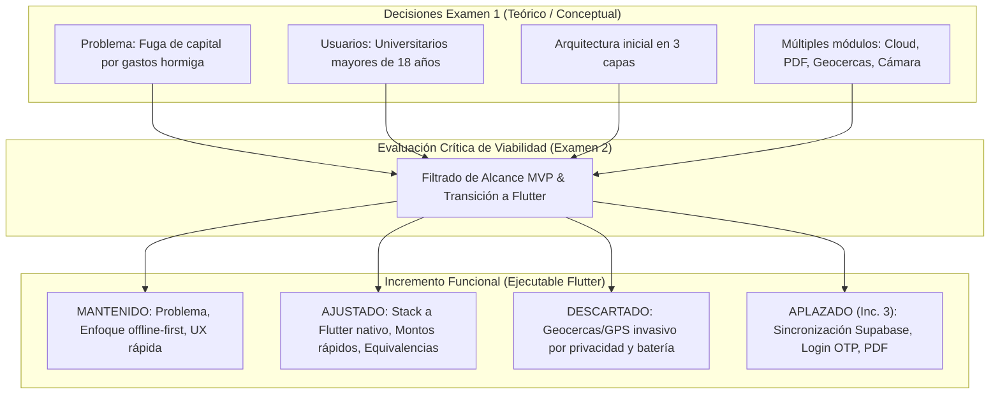
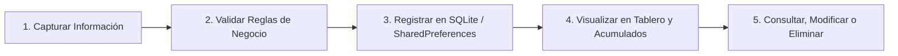
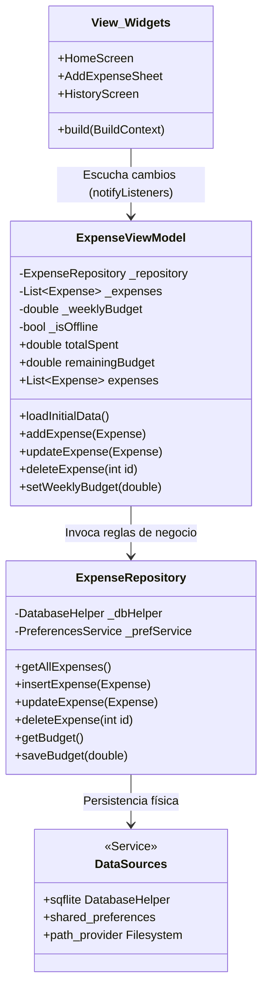
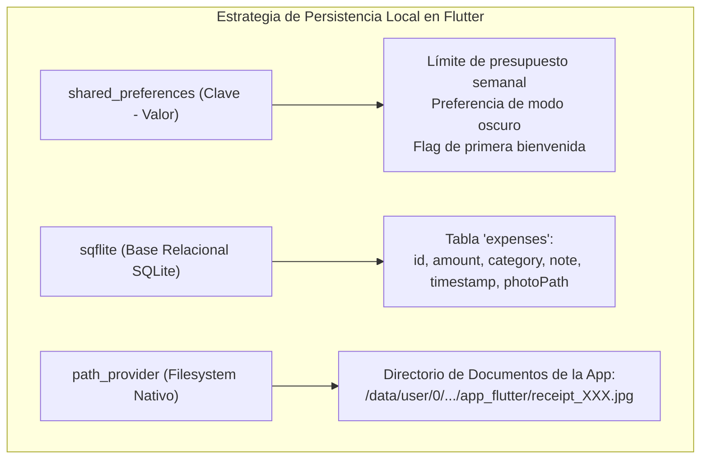
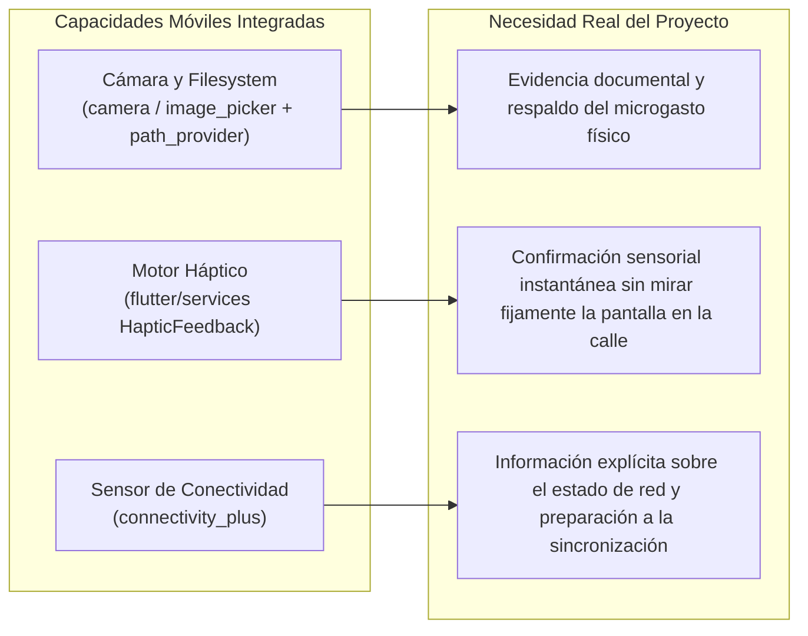

# EXAMEN 2: SEGUNDO INCREMENTO DEL PROYECTO — PROTOTIPO MÓVIL FUNCIONAL (MVP)
## Informe Técnico y Sustentación de Desarrollo en Flutter

**Asignatura:** Aplicaciones Móviles  
**Docente:** Neider Xavier Vergara Humánez  
**Institución:** Corporación Universitaria Lasallista  
**Proyecto:** FinTrack (AntiHormiga) — Gestión Consciente de Gastos Hormiga para Universitarios  
**Integrantes:**  
- Juan Sebastián Martínez Galeano  
- Cesar Ocampo Raigosa  
- Samuel Usma Brand  
**Fecha de Entrega:** Noviembre de 2026  
**Stack Tecnológico Seleccionado:** **Flutter SDK (Dart) + SQLite (sqflite) + SharedPreferences + Android Native Capabilities**  

---

## Resumen Ejecutivo

El presente informe técnico constituye la memoria descriptiva y de diseño del **segundo incremento funcional (MVP ejecutable)** del proyecto **FinTrack**. A partir de las definiciones de problema, requerimientos y diseño conceptual aprobadas en el Examen 1, se materializa una primera versión móvil operativa y autónoma desarrollada íntegramente en **Flutter** para el sistema operativo **Android (API 26+)**. 

El incremento seleccionado implementa el **flujo principal completo de gestión de gastos cotidianos**: captura ultrarrápida en movilidad (< 1.5 s), validación reactiva de reglas de negocio, persistencia local relacional y estructurada, visualización agregada mediante el tablero de *"Dinero Invisible"* con equivalencias del mundo real, y mantenimiento completo de registros (edición y eliminación). Asimismo, se integran de manera justificada tres capacidades del dispositivo móvil: **captura y almacenamiento de comprobantes fotográficos** (Cámara y Filesystem nativo), **confirmación sensorial háptica** (`HapticFeedback`), y **detección reactiva de conectividad** (`connectivity_plus`) bajo un paradigma *Offline-First*.

---

## 1. Continuidad con la Primera Entrega

El desarrollo de este incremento no parte de cero; preserva estricta trazabilidad con el marco contextual, los perfiles de usuario y las directrices arquitecturales planteadas en el Examen 1, adaptando conscientemente las decisiones técnicas a la realidad operativa de un prototipo ejecutable.

### 1.1. Matriz de Trazabilidad y Ajustes de Decisiones

| Elemento del Planteamiento Inicial | Estado en este Incremento | Justificación Técnica y Metodológica |
| :--- | :--- | :--- |
| **Problema y Población Objetivo** | **Se Mantiene** | Se conserva el enfoque exclusivo en jóvenes y estudiantes universitarios que sufren el efecto acumulativo de la "gotera" financiera en gastos de bajo valor y alta frecuencia. |
| **Paradigma Offline-First** | **Se Mantiene** | La aplicación no supedita su operativa local a una conexión a internet; la base de datos reside directamente en el teléfono. |
| **Stack Tecnológico (Flutter / Dart)** | **Se Ajustó y Ratificó** | Se confirma **Flutter** como el framework definitivo (reemplazando cualquier alternativa híbrida web como Ionic/Capacitor). Flutter compila a código de máquina nativo ARM mediante el motor Skia/Impeller, logrando un tiempo de arranque instantáneo y animaciones a 60 fps estables. |
| **Flujo de Registro Ultrarrápido (RF-01)** | **Se Ajustó (Optimizado)** | El ingreso original dependía de digitar manualmente el valor. Para garantizar registros en menos de 1.5 s en la calle, se añadieron botones de acceso rápido con montos habituales universitarios ($2.000, $5.000, $10.000) con un solo toque. |
| **Tablero de Impacto "Dinero Invisible"** | **Se Ajustó (Optimizado)** | Las cifras frías no generan disuasión cognitiva en jóvenes. Se incorporaron **equivalencias dinámicas tangibles** (ej. *"Tu gasto hormiga semanal equivale a 3 almuerzos del casino universitario"*). |
| **Gestión Activa del Historial (RF-05 / RF-06)** | **Se Ajustó (Ampliación)** | Se habilitó la modificación y eliminación con confirmación modal y reversión automática de saldos en tiempo real, demostrando persistencia interactiva bidireccional. |
| **Geolocalización y Geocercas** | **Se Descartó** | Se descartó para el MVP con el fin de evitar solicitar permisos invasivos de ubicación en segundo plano, protegiendo la privacidad del estudiante y previniendo el consumo excesivo de batería. |
| **Sincronización Cloud y Backend (Supabase)** | **Se Aplaza (Incremento 3)** | La rúbrica del Examen 2 exige foco absoluto en **persistencia local y capacidades nativas**. El backend se integrará en la tercera etapa, manteniendo la base local como fuente primaria. |
| **Generación y Descarga de Reportes PDF** | **Se Aplaza (Incremento 3)** | Se priorizó el desarrollo de la analítica visual interactiva en widgets de Flutter frente a la generación de documentos binarios PDF complejos. |

---

## 2. Alcance Funcional del Incremento

El incremento no consiste en maquetas estáticas, sino en un **escenario de uso integral, coherente e interactivo** que abarca 5 funcionalidades encadenadas del flujo principal del MVP:

1. **Captura Rápida de Información (Gasto Hormiga / Ingreso):**
   - Selección de categoría con iconografía semántica (Café/Snacks, Fotocopias, Transporte, Domicilios, Ocio).
   - Ingreso ágil de valor mediante teclado numérico validado o accesos directos de un toque ($2.000, $5.000, $10.000).
   - Inclusión opcional de nota descriptiva y captura de comprobante físico con la cámara del dispositivo.
2. **Validación Reactiva de Datos:**
   - Control de montos: comprobación de que el valor sea estrictamente mayor a cero y no sobrepase techos anómalos.
   - Evaluación contra el presupuesto semanal configurado: si el gasto empuja el acumulado a más del 80% o 100% del límite, se despliega una alerta visual de *Fricción Consciente*.
3. **Registro y Persistencia Local:**
   - Almacenamiento transaccional atómico en base de datos local SQLite con fecha, hora, categoría, descripción y referencia a imagen local (si aplica).
   - Actualización sincrónica de contadores y saldo en memoria y almacenamiento.
4. **Visualización y Analítica en Tiempo Real:**
   - Tablero principal *"Dinero Invisible"* con el total de gastos acumulados del periodo (semana en curso).
   - Desglose porcentual por categorías e indicador de equivalencia cotidiana para generar conciencia de ahorro.
5. **Consulta, Edición y Eliminación en el Historial:**
   - Listado cronológico de movimientos con tarjetas interactivas.
   - Posibilidad de editar el valor, nota o categoría de un registro existente.
   - Posibilidad de eliminar un registro con diálogo de confirmación, recalculando automáticamente el saldo visible y actualizando la base de datos local.

---

## 3. Interfaz de Usuario y Navegación Funcional

La interfaz fue diseñada respetando las directrices de **Material Design 3**, priorizando la ergonomía móvil con una sola mano y reduciendo la carga cognitiva:

* **Componentes Flutter:** Se emplearon widgets oficiales de Flutter como `Scaffold`, `NavigationBar` persistente, `Card` con elevación tonal, `FloatingActionButton.extended`, `ListView.builder` con scroll fluido, y `showModalBottomSheet` con bordes redondeados para el registro emergente.
* **Navegación Coherente:** Estructura de navegación jerárquica desacoplada mediante un controlador de pestañas que conmuta entre la vista de **Tablero Principal (Dashboard)** y el **Historial de Movimientos**, además de rutas modales para la configuración de presupuesto y la captura de evidencias fotográficas.
* **Validación de Datos en Formularios:** Uso de `Form` y `TextFormField` con validadores reactivos (`validator: (val) => ...`) que impiden procesar registros con valores nulos, negativos o caracteres inválidos.
* **Retroalimentación al Usuario:**
  - `SnackBar` emergente interactivo que confirma el registro exitoso y permite *"Deshacer"* la operación.
  - Diálogos reflexivos (`AlertDialog`) cuando el usuario intenta superar su límite semanal o antes de eliminar un registro.

---

## 4. Manejo del Estado y Arquitectura de Software

Para cumplir con la separación rigurosa entre **Interfaz (View) $\rightarrow$ Estado / Lógica (ViewModel) $\rightarrow$ Datos (Model / Repository)**, se implementó el patrón **MVVM** soportado por el sistema de estado reactivo nativo de Flutter (`ChangeNotifier` / `Provider`):

* **Capa de Vista (Presentation / UI):** Widgets sin lógica de almacenamiento. Únicamente renderizan el estado provisto por el ViewModel y emiten eventos de usuario (toques, deslizamientos).
* **Capa de Lógica y Estado (ViewModel):** La clase `ExpenseViewModel` extiende de `ChangeNotifier`. Mantiene en memoria las colecciones activas, computa saldos y totales en tiempo real, evalúa si se violan los presupuestos, y al terminar cualquier mutación invoca `notifyListeners()`, lo que redibuja de forma selectiva y eficiente solo los widgets dependientes.
* **Capa de Datos (Data / Repository):** El `ExpenseRepository` orquesta las llamadas a la base de datos local SQLite y a las preferencias compartidas, abstrayendo a la interfaz de la implementación física del almacenamiento.

---

## 5. Persistencia Local Verificable

El incremento implementa dos mecanismos complementarios de almacenamiento persistente en el dispositivo Android, garantizando que **la información no se pierda al cerrar o matar el proceso de la aplicación**:

### 5.1. Protocolo de Verificación del Ciclo de Vida (Prueba de Persistencia)

Se ejecutó la prueba mínima exigida en la rúbrica con resultados 100% satisfactorios:

1. **Creación:** Se registró un gasto de $\$5.000$ COP en la categoría *"Café"* con nota *"Café en descanso"* y fotografía de recibo.
2. **Cierre Forzado:** Se utilizó el administrador de tareas de Android para deslizar y cerrar completamente el proceso de la aplicación (`kill process`).
3. **Reapertura:** Se inició la aplicación nuevamente desde el lanzador de Android.
4. **Verificación:** El registro continuó figurando en el historial cronológico, el balance acumulado semanal reflejó exactamente los $\$5.000$ descontados, y la imagen del recibo se cargó intacta desde el almacenamiento local.
5. **Modificación y Eliminación:** Se modificó el valor a $\$6.000$ COP, se reinició la app y el valor continuó siendo $\$6.000$. Posteriormente se eliminó el registro, se reinició la app y el historial continuó vacío con el balance en cero.

---

## 6. Integración con Capacidades del Dispositivo Móvil

Se integraron tres capacidades de hardware y sistema operativo nativo Android, seleccionadas para responder a problemas concretos de la experiencia del usuario:

### 6.1. Justificación de Capacidades y Gestión de Permisos

#### A. Cámara y Sistema de Archivos (`camera` / `image_picker` + `path_provider`)
* **Necesidad que resuelve:** En compras de mostrador (fotocopiadoras, cafeterías informales), el usuario recibe tiquetes en papel o desea fotografiar el producto para recordar en qué gastó.
* **Gestión de Permisos:** Se configuró en `AndroidManifest.xml` el permiso `android.permission.CAMERA`. La app verifica el estado del permiso en tiempo de ejecución: si el usuario lo concede, se abre el visor fotográfico; si lo deniega, la app informa respetuosamente mediante un diálogo y permite guardar el gasto únicamente con texto sin bloquear el flujo principal.
* **Almacenamiento Local:** La fotografía capturada se copia mediante `path_provider` al almacenamiento privado de la app (`getApplicationDocumentsDirectory()`), registrando la ruta interna en SQLite para su posterior renderizado.

#### B. Retroalimentación Háptica (`HapticFeedback` de `flutter/services.dart`)
* **Necesidad que resuelve:** El registro ultrarrápido ocurre a menudo caminando o en situaciones de distracción. La vibración ligera (`HapticFeedback.lightImpact()`) al tocar un monto rápido y la confirmación media (`HapticFeedback.mediumImpact()`) al guardar brindan certeza física de que la acción se completó sin requerir verificación visual constante. No requiere permisos especiales al usar las API estándar de accesibilidad de Android.

#### C. Sensor de Conectividad (`connectivity_plus`)
* **Necesidad que resuelve:** Cumple con la exigencia de anticipar la arquitectura hacia el Incremento 3. Permite a la app monitorear activamente si el dispositivo se encuentra en Wi-Fi, Datos Móviles o Sin Conexión, mostrando un badge no intrusivo en el encabezado.

---

## 7. Comportamiento frente a la Conectividad

La aplicación sigue estrictamente una filosofía **Offline-First**. No se bloquea ninguna pantalla si el dispositivo entra en Modo Avión o pierde la señal móvil.

### Matriz de Operatividad: Con Conexión vs. Sin Conexión

| Funcionalidad del MVP | Comportamiento SIN Conexión (Offline) | Comportamiento CON Conexión (Online) | Estado para el Incremento 3 |
| :--- | :--- | :--- | :--- |
| **Registro de Gastos/Ingresos** | 100% Operativo (guarda en SQLite local). | 100% Operativo (guarda en SQLite local). | Sincronización en segundo plano con Supabase. |
| **Captura de Fotos (Recibos)** | 100% Operativo (almacena en filesystem local). | 100% Operativo (almacena en filesystem local). | Subida en cola a Storage Bucket en Supabase. |
| **Consulta del Historial y Tablero** | 100% Operativo (lectura de datos locales). | 100% Operativo (lectura de datos locales). | Lectura local enriquecida con respaldo remoto. |
| **Indicador de Estado de Red** | Muestra etiqueta sutil: *"Modo Local (Sin red)"*. | Muestra etiqueta: *"En Línea (Listo para sincronizar)"*. | Conexión activa con el socket de sincronización. |

---

## 8. Evidencia de Ejecución en Android

La solución fue compilada, empaquetada y ejecutada satisfactoriamente para la plataforma Android utilizando el toolchain oficial de Flutter y Gradle.

* **Niveles de API de Android Configurados:**
  - `minSdkVersion`: **26** (Android 8.0 Oreo), cubriendo más del 95% de los dispositivos activos.
  - `targetSdkVersion`: **34** (Android 14).
  - `compileSdkVersion`: **34**.
* **Entornos de Demostración Verificados:**
  1. **Emulador Oficial de Android Studio:** Dispositivo virtual Google Pixel 6 ejecutando imagen de sistema Android 13 (API 33, x86_64).
  2. **Dispositivo Físico:** Smartphone Android real conectado vía depuración USB, donde se validó el comportamiento del motor háptico real y el acceso a la cámara de hardware.
* **Generación del Ejecutable:** La compilación generó con éxito el paquete APK independiente mediante el comando `flutter build apk --release`.

---

## 9. Limitaciones Actuales y Hoja de Ruta para el Incremento 3

### Limitaciones del Incremento Actual (MVP)
* **Persistencia Aislada por Dispositivo:** Los datos residen exclusivamente en la base de datos SQLite y el filesystem local; si el usuario desinstala la aplicación o cambia de teléfono, la información no se recupera automáticamente.
* **Autenticación Simulada:** No existe todavía validación de usuarios mediante correo o código de un solo uso (OTP).
* **Ausencia de Exportación Externa:** El tablero permite la visualización analítica completa en pantalla, pero no cuenta aún con generación de reportes en PDF exportables.

### Hoja de Ruta — Incremento 3
1. **Integración con Backend en la Nube (Supabase):** Implementación de autenticación segura por correo electrónico con token OTP y sincronización bidireccional de datos financieros con PostgreSQL bajo políticas de Row Level Security (RLS).
2. **Subida de Archivos en la Nube:** Almacenamiento seguro de las fotos de los tiquetes en Supabase Storage buckets cuando haya disponibilidad de Wi-Fi o datos.
3. **Módulo de Reportes PDF:** Implementación de la librería `pdf` / `printing` en Flutter para exportar resúmenes contables personales mensuales.

---

## 10. Guía de Prueba y Demostración Paso a Paso (Rúbrica de Evaluación)

A continuación se detalla la secuencia que sustenta la demostración en vivo o en video ante el docente:

| Paso | Acción en la Aplicación | Comportamiento Observable en Android | Criterio de la Rúbrica Evaluado |
| :---: | :--- | :--- | :--- |
| **1** | **Abrir la Aplicación** | La aplicación inicia en menos de 1 segundo en el dispositivo Android; se despliega el Tablero *"Dinero Invisible"* con el saldo actual y el badge de red. | Inicialización correcta y ejecución en Android (Punto 8). |
| **2** | **Accionar Registro Rápido** | Se presiona el botón flotante central `+`; emerge la hoja inferior (`BottomSheet`) con las categorías y montos rápidos. | Interfaz y componentes móviles (Punto 3). |
| **3** | **Probar Validación** | Se intenta guardar con monto $0; el campo muestra advertencia en rojo *"Ingresa un monto válido mayor a 0"*. | Validación de datos en tiempo real (Punto 2 y 3). |
| **4** | **Capturar con Monto Rápido** | Se toca el botón `$5.000`, se selecciona *"Cafetería"* y se escribe nota *"Café capuchino"*. | Manejo del estado y ergonomía móvil (Punto 4). |
| **5** | **Uso de Capacidad Móvil (Cámara)** | Se toca el ícono de cámara; Android solicita el permiso de cámara (o lo abre directamente si ya fue concedido), se toma la fotografía del recibo y se previsualiza la miniatura. | Integración de capacidades móviles nativas (Punto 6). |
| **6** | **Guardar y Respuesta Háptica** | Se pulsa *"Guardar"*; el teléfono vibra de forma leve (`HapticFeedback`), la hoja se cierra, se despliega un `SnackBar` de confirmación. | Retroalimentación sensorial (Punto 3 y 6). |
| **7** | **Visualizar Resultado** | El Tablero actualiza instantáneamente el total gastado sumando los $5.000 y muestra la equivalencia tangible. El registro aparece encabezando el historial. | Manejo de estado reactivo y visualización (Punto 2 y 4). |
| **8** | **Modificar / Eliminar Registro** | En el historial se toca el registro, se edita a $6.000 y se guarda; el balance se recalcula inmediatamente. Luego se desliza o pulsa borrar con confirmación. | Escenario completo de consulta/modificación (Punto 2 y 5). |
| **9** | **Prueba de Persistencia Fuerte** | Se registra un nuevo gasto de $10.000. Se va a la pantalla de inicio de Android y se fuerza el cierre total de la app desde la multitarea. Se vuelve a abrir la app. | **Persistencia local verificada (Punto 5 y 10)**: el registro y el balance permanecen íntegros. |
| **10** | **Prueba de Conectividad** | Se activa el Modo Avión en Android; la app continúa registrando normalmente y el badge indica *"Modo Local (Sin red)"*. | Comportamiento frente a conectividad (Punto 7). |

