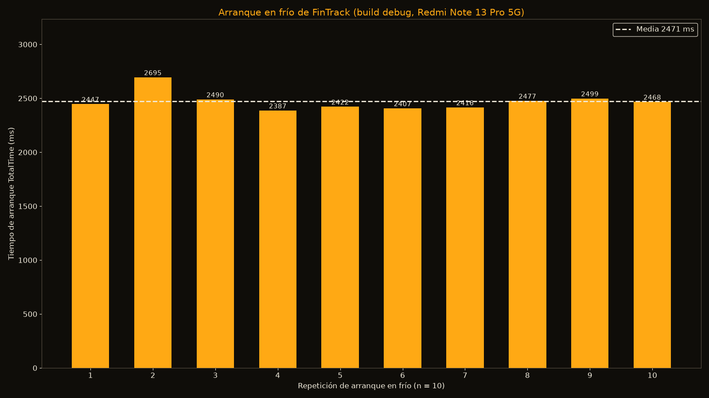
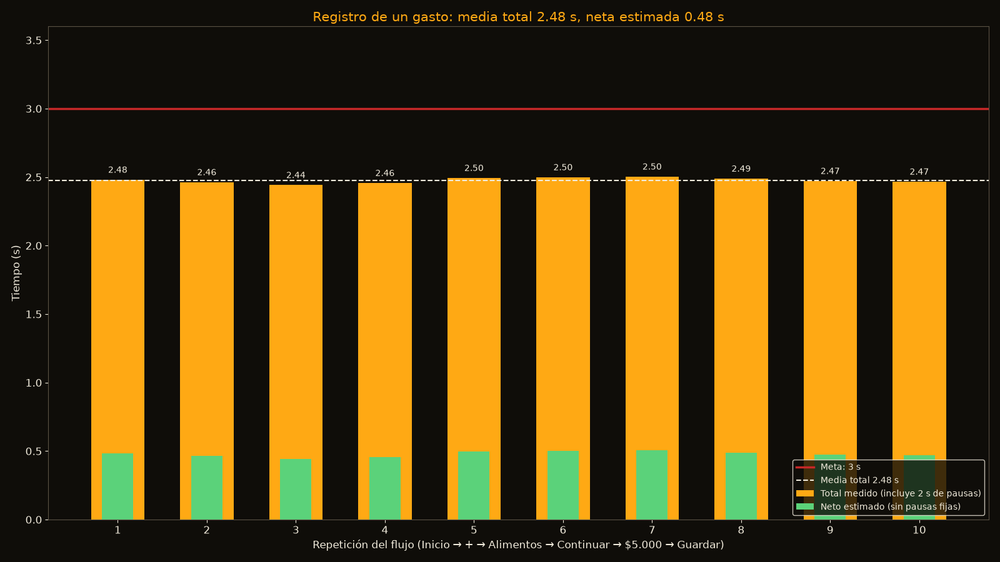
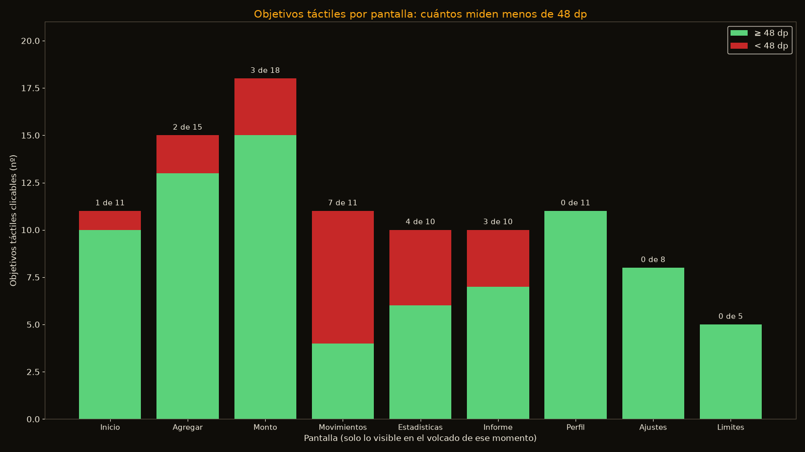
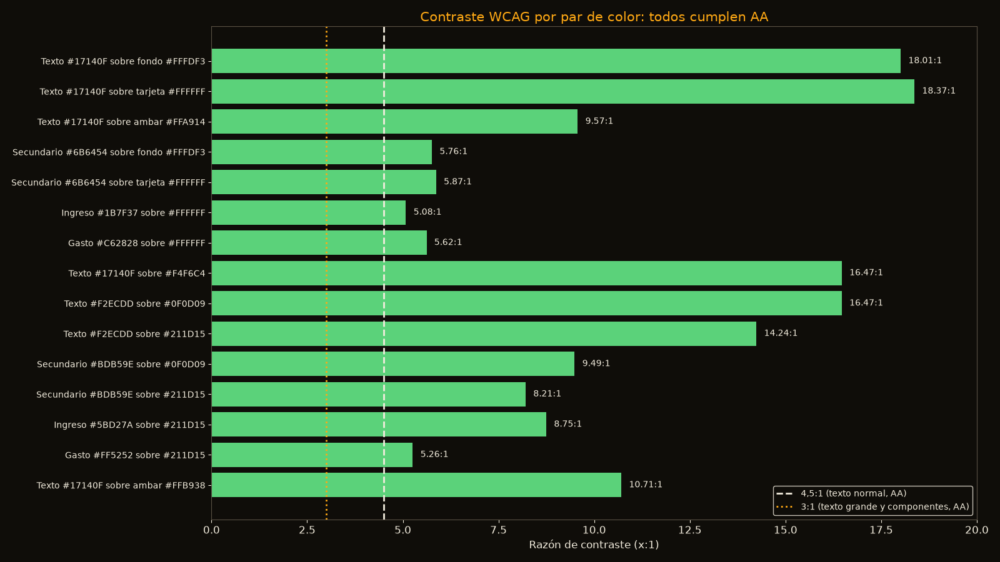

# Pruebas de tiempo y accesibilidad de FinTrack

Dispositivo: Xiaomi Redmi Note 13 Pro 5G (pantalla 1220×2712 px, 480 dpi = 3 px/dp), conectado por USB.
Aplicación: `com.unilasallista.fintrack_app`, **compilación debug** (en release los tiempos serían menores).
Un solo dispositivo. Las pruebas de tiempo se hicieron con la sesión iniciada y datos de prueba.

## Resumen

| Prueba | Resultado | Cumple |
|---|---|---|
| Arranque en frío (10 repeticiones) | Media 2.471 ms (rango 2.387–2.695 ms) | Sí (sin meta fijada; ver nota) |
| Registro de un gasto, tiempo total medido (10 repeticiones) | Media 2,48 s (rango 2.443–2.505 ms) | Sí, meta de 3 s |
| Registro de un gasto, neto estimado | Media 0,48 s (sin las pausas fijas del script) | Sí |
| Repeticiones que superan 3 s | 0 de 10 | Sí |
| Fluidez (cuadros lentos) | **No medido** (ver sección 3) | No concluyente |
| Memoria (TOTAL PSS) | 447.462 KB ≈ 437 MB, tras navegar | Informativo |
| Tamaño del APK debug | 192.025.678 bytes ≈ 183 MiB | Informativo (debug) |
| Objetivos táctiles < 48 dp | 20 de 99 objetivos en 9 pantallas | **No cumple** |
| Objetivos táctiles < 24 dp (WCAG 2.2 2.5.8) | 0 de 99 | Sí |
| Contraste WCAG AA (15 pares) | 15 de 15 cumplen | Sí |
| Escala de texto 1.3 (Inicio, Monto, Ajustes) | Sin franjas de desbordamiento; un botón cerca de la barra del sistema | Parcial |
| Etiquetas semánticas en objetivos clicables | 68 de 99 con etiqueta; 31 sin etiqueta | No completo |

## Correcciones posteriores a la medición

- **Objetivos táctiles:** tras esta prueba se subieron a 48 dp las pestañas (Todos/Ingresos/Gastos, Semana/Mes/Año, Ingreso/Gasto), los chips de filtro de Movimientos y los chips de monto. Se volvió a medir **solo Movimientos** con `uiautomator`: pestañas de 48 dp y chips de 49 dp; las demás pantallas comparten el mismo componente pero no se re-midieron. Se agregó margen inferior en Monto. La gráfica de objetivos muestra la medición **original**.
- **Límite y registro:** el diálogo «¿Seguro?» que apareció en las repeticiones 9 y 10 es la pausa de fricción consciente funcionando (el gasto superaba el límite semanal hormiga de $50.000). Se vio en pantalla durante las pruebas, pero no quedó captura.
- **Lectura del tiempo de registro:** la secuencia usa pausas fijas y toques sin esperar la respuesta de la app, así que el «neto 0,48 s» es solo una cota inferior; el dato sólido es que el flujo completo cabe en ~2,5 s con pausas generosas (meta del proyecto: < 3 s). No es una medición de latencia de la interfaz.

## 1. Arranque en frío

- Método: 10 veces `am force-stop` + `am start -W -n com.unilasallista.fintrack_app/.MainActivity`; se toma `TotalTime`.
- `ThisTime` no lo devolvió el equipo en este modo de `am start -W` (el dato está en `arranque_raw.csv`). Un solo dispositivo, build debug.
- Datos: `arranque_raw.csv`, `tiempos.csv`.

## 2. Registro de un gasto

- Método: un solo `adb shell` por repetición con la secuencia Inicio → «+» → Alimentos → Continuar → $5.000 → Guardar. Hay 5 pausas fijas de 0,4 s (2.000 ms) que no son de la app; el tiempo neto estimado resta esas pausas. Se toma `date +%s%N` del propio teléfono.
- Cada repetición mide hasta que termina la pausa final, no hasta que aparece «Gasto registrado», así que el neto es una estimación.
- **Problema detectado:** al superar el límite semanal hormiga aparece un diálogo «¿Seguro?» («Guardar igual» / «Cancelar») que la secuencia no contempla. La verificación por saldo y lista confirma **8 gastos guardados de 10 repeticiones**; las 2 últimas no se confirmaron (muy probablemente las repeticiones 9 y 10, bloqueadas por ese diálogo). Sus tiempos aparecen en la gráfica, pero no deben tomarse como registros completos.
- Limpieza: se eliminaron los 9 gastos de prueba (1 manual + 8 repeticiones). El saldo volvió a $94.500 y la lista quedó con los movimientos originales.
- Datos: `registro_raw.csv`, `tiempos.csv`, `scripts/registro_gasto.sh` (referencia del flujo).

## 3. Fluidez (no medida)

- `dumpsys gfxinfo` reportó 0 cuadros para la app: Flutter dibuja fuera de la vista de Android en esta build, y el resultado no sirve.
- `dumpsys SurfaceFlinger --latency` no devolvió marcas de cuadro para las capas de la app.
- logcat no mostró mensajes «Skipped frames».
- Por eso **no hay gráfica de fluidez** y no se reporta ningún porcentaje de cuadros lentos. Medirla requiere un build *profile* con DevTools, o el panel de rendimiento de Flutter.

## 4. Memoria

- `dumpsys meminfo`: TOTAL PSS 447.462 KB (≈437 MB), TOTAL RSS 603.784 KB. Se tomó después de navegar y desplazar la pantalla, no justo tras el arranque. Es un valor de uso, no de arranque.

## 5. Tamaño del APK

- `app-debug.apk`: 192.025.678 bytes (≈183 MiB). Build debug, sin reducir.

## 6. Objetivos táctiles

- Método: `uiautomator dump` en Inicio, Agregar, Monto, Movimientos, Estadísticas, Informe, Perfil, Ajustes y Límites. Se toman los nodos `clickable="true"` con tamaño > 0, sin duplicados. dp = px / 3.
- Solo cuenta lo que el volcado ve en ese momento (listas desplazadas no incluidas).
- Resultado: 20 de 99 objetivos miden menos de 48 dp; ninguno menos de 24 dp.
- Más pequeños y dónde están:
  - Movimientos: chips de filtro («Todas», «Alimentos», «Trabajo», «Transporte») de 35 dp de alto. 7 de 11 objetivos están por debajo de 48 dp.
  - Monto: chips «$ 2.000», «$ 5.000», «$ 10.000» de 35 dp de alto.
  - Agregar: pestañas «Ingreso» y «Gasto» de 44 dp de alto.
  - Estadísticas e Informe: «Semana», «Mes», «Año» de 44 dp de alto.
  - Inicio: la fila «Taxi a la u» aparece con 26 dp de alto porque la barra inferior la tapa. Es un recorte visual, no un objetivo pequeño por diseño.
- Etiquetas: de 99 objetivos, 68 tienen `content-desc` o `text`, y 31 no (`accesibilidad.csv`).

## 7. Contraste de color

- Fórmula WCAG de luminancia relativa (`scripts/contraste.py`). Umbrales: 4,5:1 para texto normal y 3:1 para texto grande y componentes.
- Los 15 pares cumplen AA. El más justo es ingreso `#1B7F37` sobre blanco con 5,08:1; el gasto oscuro `#FF5252` sobre `#211D15` da 5,26:1.

## 8. Escala de texto 1.3

- Se configuró `font_scale 1.3` y se restauró a 1,0 al terminar (verificado).
- Capturas: `escala_1.3_inicio.png`, `escala_1.3_monto.png`, `escala_1.3_ajustes.png`.
- Inicio: «Añadir dinero» pasa a dos líneas; no hay texto cortado.
- Monto: el botón «Guardar gasto» queda parcialmente bajo la barra de navegación del sistema. No hay franjas amarillas de desbordamiento.
- Ajustes: sin problemas visibles.

## 9. Etiquetas semánticas

- Proxy: nodos clicables con `content-desc` o `text` no vacío. Hay 68 con etiqueta y 31 sin ella (`accesibilidad.csv`, columna `con_etiqueta`). El valor es un indicador, no una prueba con TalkBack.

## Qué no cumple y sugerencias (no aplicadas)

1. Subir a 48 dp de alto los chips de filtro de Movimientos, los chips de Monto y las pestañas de Agregar/Estadísticas/Informe (padding vertical o `minimumSize`).
2. Dar etiqueta semántica a los 31 objetivos sin texto (iconos de «+», flechas, chips), por ejemplo con `Semantics(label: ...)`.
3. Dejar margen inferior en la pantalla Monto para que «Guardar gasto» no quede bajo la barra del sistema con escala de texto grande.
4. Medir fluidez con build *profile* y DevTools, porque esta prueba no se pudo obtener.
5. Para el flujo de registro: considerar el diálogo de límite como paso esperado en las pruebas automatizadas, o usar un monto que no lo dispare.

## Restauración

- `font_scale` = 1.0 (verificado). Accesibilidad del sistema sin cambios (`accessibility_enabled` = 0).
- Gastos de prueba eliminados. Saldo $94.500, movimientos originales.
- App abierta en Inicio.

## Archivos

- `tiempos.csv`, `accesibilidad.csv`, `contraste.csv`, `arranque_raw.csv`, `registro_raw.csv`
- Gráficas: `grafica_arranque.png`, `grafica_registro.png`, `grafica_objetivos_tactiles.png`, `grafica_contraste.png`
- Scripts: `scripts/graficas.py`, `scripts/contraste.py`, `scripts/accesibilidad_objetivos.py`, `scripts/registro_gasto.sh`; volcados XML en `scripts/xml/`
